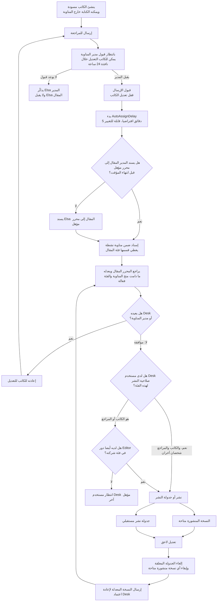
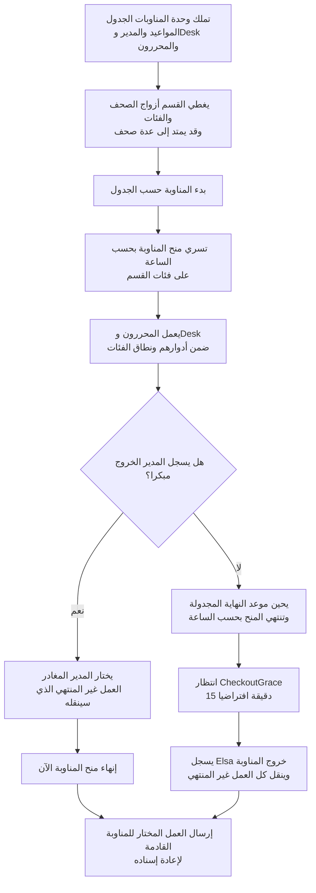

:::caution[الحالة]
نهائية، ومتفق عليها مع المستخدم. البنود الموسومة *(مفترض)* أوصي بها ولم يعترض عليها أحد، لكنها لم تؤكد صراحة.
**هذه الصفحة هي قرار التصميم.** وقد بدأ التنفيذ: جانب المضيف من الخطوات 1 و2 و4 ووسيط المستأجر موجودة في `main`،
وخدمة الهوية في فرع مستقل. انظر [المصادقة: التنفيذ](/ar/backend/auth-implementation/) و[المستأجرون وبياناتهم](/ar/backend/tenancy-data/).
:::

## 1. المبادئ

1. تعمل الهوية خدمة مستقلة، ولا تكون أبدا وحدة تشغيل.
2. تعمل الوحدات بأسماء الصلاحيات (نصوص عادية). وكل أنواع التفويض ملك للمضيف، فتبقى الوحدات
   [قابلة للتفريغ](/ar/backend/runtime-module-unloading/).
3. المنحة صلاحية × نطاق × نافذة صلاحية زمنية، داخل مستأجر واحد. وتبحث المنح على الخادم، ولا تحمل في الرمز أبدا.
4. يفرض المضيف والوحدات القواعد وقت الطلب. أما Elsa ووحدة المناوبات فلا تفعلان سوى *إنتاج* المنح وتغييرات الحالة.
5. تفرض القواعد الزمنية بالساعة، لا بمؤقت أبدا. فالمكون المتوقف أو غير المفعل لا يترك أحدا بوصول لا يحق له.
6. الشيفرة متعددة المستأجرين دائما. والنشر المخصص هو الصور نفسها بمستأجر واحد.

## 2. نماذج النشر

| | SaaS مشترك (اشتراكات) | نشر مخصص (عند الطلب) |
| --- | --- | --- |
| المستأجرون | كثيرون: كل شركة عميلة مستأجر | واحد |
| خدمة الهوية | مصدر واحد مشترك | خدمة العميل الخاصة، بمفاتيح توقيع خاصة بها |
| البيانات | قاعدة الهوية مشتركة (TenantId على الصفوف)؛ وقاعدة محتوى لكل مستأجر | كلها ملك العميل |
| الوحدات | يثبتها مشغل المنصة؛ ومقيدة بخطة كل مستأجر | الحزم الموقعة من المورد فقط |

## 3. الهوية والمصادقة

- **خدمة الهوية:** OpenIddict مع ASP.NET Core Identity، في مشروع Aspire وقاعدة بيانات خاصين بها.
  - تملك: الحسابات، وبيانات الاعتماد، والمصادقة متعددة العوامل، والقفل، والاسترداد، وتأكيد البريد، وتسجيل الدخول
    الخارجي (Entra أو Google لكل مستأجر، كمخططات ديناميكية)، وعضويات المستأجرين، وإصدار الرموز.
  - صفحات تسجيل دخول بعلامة المستأجر.
- **الحسابات:** حساب عام واحد لكل شخص.
  - `TenantMemberships(UserId, TenantId, status, invitedBy, joinedAt)`، مع ملف شخصي لكل مستأجر.
  - سجل الدخول مرة، واختر مستأجرا (أو يختاره النطاق الفرعي)، واحصل على رمز لمستأجر **واحد**. وتبديل المستأجر يعني
    رمزا جديدا دون تسجيل دخول جديد.
  - تفحص العضوية كلما أصدر رمز أو جدد.
- **سياسة أمان المستأجر، تفرض عند إصدار رمز لذلك المستأجر:** إلزام المصادقة متعددة العوامل (مع التسجيل أولا)، وإلزام
  مزود هوية المستأجر نفسه (`idp`/`amr`)، وحد أقصى لمدة الجلسة. أما سياسة كلمات المرور فعلى مستوى المنصة.
- **الرموز:**
  - المدة والتوقيع: رموز وصول JWT لمدة 5–15 دقيقة مع رموز تجديد. شهادات توقيع غير متماثلة، تحفظ في قاعدة البيانات
    أو خزنة مفاتيح وتدور؛ ولا تحصل النسخ إلا على المفاتيح العامة.
  - المطالبات: `sub` (عام)، و`tenant`، وأدوار المنصة. ولا مطالبات أبدا للصحيفة أو الفئة أو المناوبة أو الصلاحية.
- **العملاء:**
  - Blazor: Authorization Code مع PKCE، خلف BFF.
  - Elsa والعمال: client credentials.
- **أين تفحص الرموز** *(مفترض)*:
  - تفحص كل نسخة من WebApi الرموز ولها الكلمة الأخيرة.
  - ترفض بوابة YARP الرموز غير الصالحة، وتطبق حدود المعدل لكل مستخدم ومستأجر، وتزيل الترويسات القابلة للتزوير. ولا
    تتخذ أي قرار بشأن المسارات.
- **البنية التحتية:** تذهب مفاتيح Data Protection إلى Redis.

## 4. تعدد المستأجرين

- **تطابق المستأجر:** يجب أن يساوي مستأجر الطلب (النطاق الفرعي أو `X-Tenant`) مستأجر الرمز؛ وإلا 403. وتحديد المستأجر
  وسيط (middleware) في المضيف؛ وتحتفظ وحدة `tenancy` بالدليل.
- **فحص العضوية:** يفحص المضيف العضوية النشطة في كل طلب (مخزنة مؤقتا، وتمسح عبر الوسيط).
  - إزالة العضوية تلغي رموز التجديد لذلك المستأجر وتنهي الوصول خلال ثوان.
- **النطاقات داخل المستأجر:** الصحف والفئات. والنطاق مجموعة أزواج (صحيفة، فئة)، فيمكن لقسم مناوبة أن يمتد عبر صحف.
- **مستويان للإدارة:**
  - مشغل المنصة: يثبت الوحدات، ويجهز المستأجرين، ويدير الاشتراكات.
  - مسؤول المستأجر: يدعو بالبريد (ويقبل المستخدم)، ويعلق الأعضاء أو يزيلهم، ويدير الأدوار والمنح والإعدادات. ولا
    يستطيع إعادة تعيين كلمات المرور، ولا تغيير البريد، ولا حذف الحسابات، ولا رؤية مستأجري المستخدم الآخرين.
- **الاشتراكات:** فهرس الوحدات عام؛ وخطة كل مستأجر تفعل الوحدات أو توقفها لذلك المستأجر (فحص في المضيف). وإعدادات
  الوحدات قيم افتراضية عامة مع تجاوزات لكل مستأجر.
- **مفاتيحها المستأجر:** المنح، و`IAccessScopes`، والذاكرة المؤقتة، والتدقيق، وسير عمل Elsa ومؤقتاته.
- **حذف الحساب:** يحتفظ محتوى المستأجر بقيمة `sub` ويصبح اسم الكاتب مستعارا.
- **نقل مستأجر من SaaS إلى نشر مخصص:** انسخ حسابات أعضائه (ثم إعادة تعيين كلمة المرور، أو اتحاد هوية مع خدمة هوية
  SaaS).

انظر أيضا [تعدد المستأجرين عبر المجموعات](/ar/backend/multitenancy/).

## 5. نموذج التفويض (المضيف)

- **المنح:** `(tenant, user, permission, scope, validFrom, validTo, source)`.
  - منح دائمة: `content.author` و`content.editor` لكل فئة أو صحيفة.
  - منح المناوبات تأتي من جدول المناوبات (تكتبها وحدة المناوبات). صالحة من البداية المجدولة حتى أسبق الموعدين: تسجيل
    الخروج أو النهاية المجدولة.

| دور الجدول (لكل مناوبة) | المنح |
| --- | --- |
| Manager | content.accept، content.assign، content.transfer، content.return |
| Desk | content.publish، content.return |
| Editor | content.review (المقالات المسندة فقط) |

- **`IAccessScopes` (في Contracts):** يجيب عن "النطاقات التي يملك فيها هذا المستخدم الصلاحية P في هذا المستأجر الآن".
  يستخدم لفحص مقال واحد ولمرشحات القوائم. ويخزن مؤقتا حتى حد النافذة التالي، ويمسح عبر الوسيط.
- **التدقيق:** يسجل كل إجراء من نفذه، ومن بدأه، والمستأجر، والمنحة أو المناوبة التي سمحت به.
- **أسماء الصلاحيات:** يبقى `content.editor` (دائمة) و`content.review` (مناوبة) منفصلين.

## 6. تفويض نقاط النهاية في وحدات التشغيل

- **التصريح بالصلاحيات:** يبني `RequirePermission("...")` (في Contracts) السياسة مباشرة على نقطة النهاية. ويصرح
  `ModuleManifest.Permissions` بصلاحيات الوحدة؛ ويفشل التفعيل إن استخدمت نقطة نهاية صلاحية غير مصرح بها.
- **الافتراضي:** يلزم مستخدم مسجل الدخول؛ وتنسحب الوحدات من ذلك بـ `AllowAnonymous`.
- **أمان التفريغ:** ترفض عند التفعيل أنواع `IAuthorizationRequirement` المعرفة في الوحدة. والفحوص الدقيقة شيفرة في
  الوحدة تستدعي `IAccessScopes`.
- **للتحقق:** أن `AuthorizationPolicyCache` يحرر نقاط نهاية الوحدة عند التفريغ (اختبار gcroot، كما في
  [تفريغ وحدات التشغيل](/ar/backend/runtime-module-unloading/)).
- **واجهة إدارة الوحدات:** يتطلب `/api/admin/modules` الصلاحية `platform.modules.manage`، لمشغل المنصة فقط. وتسجل
  السياسة عند البدء. ولا تمر أبدا عبر البوابة العامة في الإنتاج. ويأتي توقيع الحزم بعد ذلك.

## 7. سير عمل المحتوى (تملك وحدة المحتوى الحالة)

- **تعديل المالك:** الحالة ∈ {draft, returned} ∨ (submitted ∧ الآن < submittedAt + OwnerEditWindow ∧ لم يقبل ولم
  يسند). القبول أو الإسناد يمنع المالك فورا.
- **تعديل المسند إليه:** مسند إليه ∧ مناوبة الإسناد نشطة الآن ∧ content.review ضمن النطاق.
- **الإسناد:**
  - يحتاج إلى content.assign ضمن النطاق الآن.
  - يجب أن يكون المسند إليه Editor في الجدول ضمن مناوبة نشطة تغطي الفئة.
  - مقارنة وتعيين على الحالة؛ والخاسر يحصل على 409. وإن لم يوجد مؤهل → يبقى المقال في الطابور ويصعد Elsa الأمر.
- **النشر:** content.publish ضمن النطاق الآن ∧ (ليس الكاتب ولا المراجع ∨ content.editor دائمة على فئة المقال).
- **النشر المجدول:** يفحص الحق وقت الجدولة. ويظل ينشر بعد انتهاء مناوبة مستخدم Desk؛ وأي تعديل يلغيه.
- **الطلبات غير المقبولة:** تبقى submitted. يذكر Elsa المدير، وتنتقل مع التسليم. ولا يقبل Elsa أبدا.

## 8. المناوبات والتسليم

- **الجدول:** جدول تملكه وحدة المناوبات، وهي التي تكتب منح المناوبات. ويشغل Elsa العمليات المحيطة به.
- **تسجيل الخروج:**
  - ينهي الوصول مبكرا.
  - يختار المدير المغادر أي عمل غير منته ينتقل.
  - إن لم يسجل أحد الخروج حتى النهاية المجدولة + CheckoutGrace، يسجل Elsa خروج المناوبة وينقل كل العمل غير المنتهي
    إلى طابور المناوبة القادمة (`transferredFrom`). وكان الوصول قد انتهى بالساعة أصلا.
- **الإعدادات:** AutoAssignDelay = 5m، وCheckoutGrace = 15m، وOwnerEditWindow = 24h.
  - قيم افتراضية للمنصة، وتجاوزات للمستأجر، وتجاوزات للقسم.
  - تغييرها يتطلب `newsroom.settings.manage`.

### مخطط دورة المناوبة

تملك وحدة المناوبات الجدول ومنح المناوبة. وتملك وحدة المحتوى حالات المقالات. وينسق Elsa تذكير القبول ومؤقتات الإسناد وتسجيل الخروج التلقائي والتسليم وجدولة النشر.

## 9. Elsa 3 (خادم Elsa داخل وحدة تشغيل خاصة به)

- **الموقع:** مجموعة `workflow` مخصصة بلا وحدات أخرى.
  - `HotUnload = false`: الترقيات إعادة تشغيل متدرجة.
  - أقفال Redis موزعة؛ ومخطط Postgres خاص به؛ وتعدد المستأجرين في Elsa مفعل.
- **فجوات في بيئة التشغيل يجب بناؤها:**
  - تشغيل الخدمات المستضافة للوحدة وإيقافها؛
  - مسار شامل يشغل خط معالجة فرعيا خاصا لواجهة Elsa البرمجية وStudio (يحتاج إلى تجربة استكشافية).
- **الأمان:**
  - الهوية المدمجة في Elsa معطلة. ويحول تحويل المطالبات في المضيف `workflows.design` و`workflows.run` إلى مطالبات
    صلاحيات Elsa. وتصميم سير العمل حق على مستوى المنصة.
  - يسجل Elsa الدخول كعميل `elsa-workflows` ويستدعي واجهات وحدتي المحتوى والمناوبات عبر HTTP. ويحمل كل استدعاء
    المستأجر، ويفحصه المضيف.
  - لا يجوز لـ Elsa إصدار منح إلا من قوالب المناوبات. ويسجل كل إجراء بالفاعل = elsa ومن بدأه.

## 10. المسؤوليات

| المكون | يملك |
| --- | --- |
| خدمة الهوية (OpenIddict) | الحسابات، والعضويات، وبيانات الاعتماد، والمصادقة متعددة العوامل، ومزودو الهوية الخارجيون، وسياسة أمان المستأجر، وإصدار الرموز |
| مضيف WebApi | فحص الرموز، وتطابق المستأجر وفحص العضوية، وتقييد الاشتراكات، والسياسة الاحتياطية، ومخزن المنح، و`IAccessScopes`، وخطافات التدقيق، وسياسة واجهة الإدارة، وتحويل مطالبات Elsa |
| `WebApi.Contracts` | `RequirePermission`، و`PermissionRequirement`، وأسماء المطالبات، و`ModuleManifest.Permissions`، و`IAccessScopes`، و`IGrantStore` |
| وحدة التشغيل `identity` *(مفترض؛ وقد تسمى `access`)* | واجهة إدارة المنح والأدوار (تفحص منح Elsa مقابل القوالب)، وفهرس الصلاحيات، و`/me` |
| وحدة التشغيل `tenancy` | دليل المستأجرين، وإدارة الخطط وتفعيل الوحدات |
| وحدة المناوبات | الجدول، والأقسام، وتسجيل الدخول والخروج، وكتابة منح المناوبات |
| وحدة المحتوى | الحالات، والنوافذ الزمنية، والمالك والمسند إليه، وواجهة الانتقالات، ومرشحات القوائم |
| وحدة Elsa | التنسيق: الإسناد التلقائي، والتذكيرات، وتسجيل الخروج التلقائي، والتسليم، والنشر المجدول |
| بوابة YARP | رفض الرموز غير الصالحة، وحدود المعدل، وإزالة الترويسات، وBFF |

## 11. ترتيب التنفيذ (عند الطلب)

1. خدمة الهوية (OpenIddict) في Aspire. وJwtBearer والسياسة الاحتياطية وحماية واجهة الإدارة في المضيف.
2. Contracts: `RequirePermission` وصلاحيات البيان، مع فحص التفعيل. واختبار تفريغ ذاكرة السياسات المؤقتة.
3. وسيط المستأجر، وفحص العضوية، وتقييد الاشتراكات.
4. مخزن المنح، و`IAccessScopes`، وتحويل المطالبات.
5. وحدتا المناوبات والمحتوى مع قواعد سير العمل.
6. فجوات بيئة التشغيل لـ Elsa (الخدمات المستضافة، وتجربة خط المعالجة الفرعي)، ثم وحدة Elsa.
