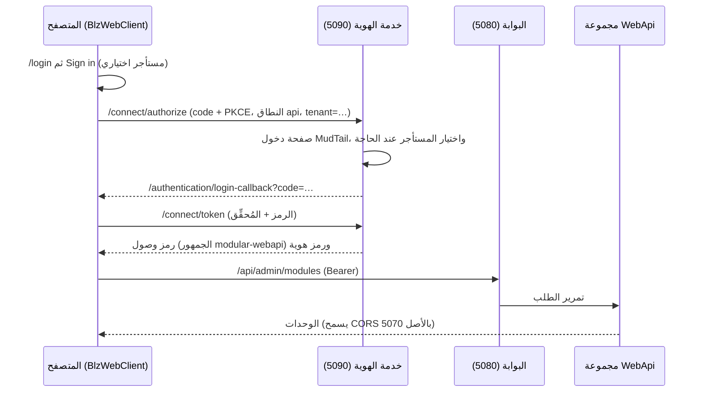
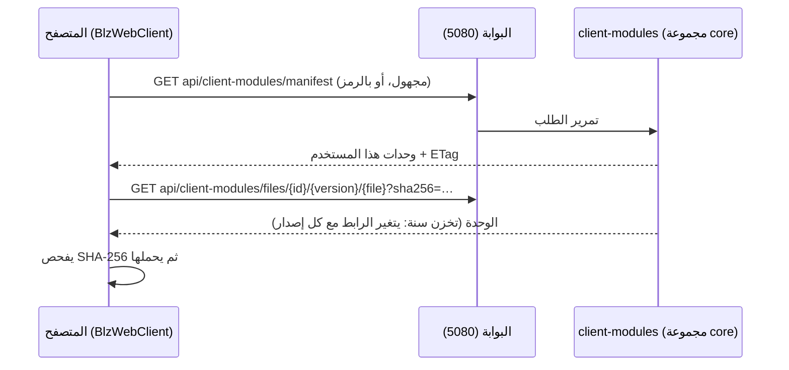

`src/apps/blazor/ModularBlazor.BlzWebClient` هو عميل Blazor WebAssembly لمنصة WebApi. وهو يحل محل
`ModularBlazor.Client` الذي يخاطب المشروع المتقادم `api/ModularBlazor.Host`. يحتفظ بنظام الوحدات في العميل القديم
(الكتالوج والمحمل والتخطيطات والموجه)، ويغير ثلاثة أشياء:

| | `ModularBlazor.Client` (القديم) | `ModularBlazor.BlzWebClient` |
| --- | --- | --- |
| تسجيل الدخول | نموذج كلمة مرور (Module.Auth) يرسل إلى Host؛ ويحفظ JWT في التخزين المحلي | OpenID Connect مع خدمة الهوية OpenIddict: Authorization Code مع PKCE |
| كتالوج وحدات العميل | وحدة Catalog في Host (`/api/modules/core` و`/api/me/modules`) | الوحدة الأساسية client-modules في WebApi (‏`/api/client-modules/manifest`)، مرشحة لكل مستخدم على الخادم |
| إدارة وحدات المضيف | Module.Admin عبر `IModuleAdminApi` (‏`/api/v1/modules` في Host) | صفحة خاصة به عبر `WebApi.Client` (‏`/api/admin/modules` خلف البوابة) |
| الجداول والنماذج | HTML عادي | MudTail، من الوحدة Layouts.Default |

## التشغيل

يشغله مختبر Aspire بكل ما يحتاجه، كالمورد `blzwebclient` على المنفذ 5070، بعد جاهزية `identity` و`gateway`:

```bash
dotnet run --project src/Aspire/Hybird --launch-profile http
```

افتح `http://localhost:5070`، واختر **Sign in**، واستخدم حساب تطوير من `appsettings.Development.json` في خدمة
الهوية. يملك `admin@modular.local` الدور `platform-admin`، فيرى أيضا **Host modules** و**Client modules** في القائمة.

ومن دون Aspire، شغل خدمة الهوية (5090) وبوابة (5080) بنفسك، ثم:

```bash
dotnet run --project src/apps/blazor/ModularBlazor.BlzWebClient
```

:::caution[إعادة البناء أثناء تشغيل المختبر]
يقرأ خادم تطوير WebAssembly قائمة الملفات الثابتة مرة واحدة عند البدء. بعد إعادة بناء العميل، أعد تشغيل المورد
`blzwebclient` من لوحة Aspire، وإلا رفض المتصفح الملفات الجديدة (فشل فحص السلامة) وبقي التطبيق على
"Loading core modules…".
:::

## الإعدادات

يعمل تطبيق WebAssembly في المتصفح ولا يقرأ متغيرات البيئة التي يضبطها Aspire، لذا توجد العناوين في
`wwwroot/appsettings.json`:

```json
{
  "Oidc": {
    "Authority": "http://localhost:5090/",
    "ClientId": "blazor-client",
    "ResponseType": "code",
    "DefaultScopes": [ "openid", "profile", "email", "api" ],
    "RedirectUri": "authentication/login-callback",
    "PostLogoutRedirectUri": "authentication/logout-callback"
  },
  "WebApi": {
    "BaseUrl": "http://localhost:5080/",
    "Pools": [ "core", "sales", "worker", "workflow" ]
  }
}
```

منفذ التطبيق جزء من تسجيله، فيجب أن تتفق معه كل هذه الإعدادات (5070 في المختبر):

| المكان | الإعداد |
| --- | --- |
| `appsettings.json` في خدمة الهوية | يحتوي `Identity:BlazorClient:RedirectUris` و`PostLogoutRedirectUris` على `http://localhost:5070/authentication/login-callback` و`.../logout-callback`. ويحدّث المُهيِّئ التطبيق `blazor-client` عند البدء |
| `appsettings.Development.json` في خدمة الهوية | يحتوي `Cors:AllowedOrigins` على `http://localhost:5070` (يستدعي المتصفح نقطة إصدار الرموز) |
| مجموعات WebApi | يحتوي `Cors:AllowedOrigins` على `http://localhost:5070`. يضبط AppHost المتغير `Cors__AllowedOrigins__0` على كل نسخة؛ وهو فارغ افتراضيا |
| AppHost | `BlzWebClientPort` و`BlzWebClientOrigin` في `src/Aspire/Hybird/AppHost.cs` |

## تسجيل الدخول



- يسجل `Auth/AuthServiceExtensions.cs` الدالة `AddOidcAuthentication` (القسم `Oidc`)، والأدوار من المطالبة `role`،
  وHttpClient باسم `WebApi`. ولا يضيف `AuthorizationMessageHandler` الرمز إلا إلى طلبات البوابة.
- ينفذ `Auth/OidcAuthenticationService.cs` الواجهة `IAuthenticationService` للوحدات. يعيد `NavigateToExternalLogin`
  و`ReLoginAsync` التوجيه إلى خدمة الهوية، وينهي `LogoutAsync` جلسة الهوية أيضا. أما `LoginAsync` بكلمة المرور من
  العميل القديم فيرمي `NotSupportedException`: تكتب كلمة المرور في صفحة خدمة الهوية، ولا تصل إلى هذا التطبيق أبدا.
- يرسل حقل المستأجر في `/login` كمعامل التفويض `tenant`، فيرتبط الرمز بذلك المستأجر. وإن ترك فارغا، يحصل المستخدم
  ذو العضوية الواحدة على مستأجره، ويختار صاحب العضويات المتعددة في خدمة الهوية، ويحصل حساب المنصة على رمز بلا مستأجر.
- يقسم `Auth/OidcClaimsPrincipalFactory.cs` مطالبة `role` التي تحمل مصفوفة JSON إلى مطالبة لكل دور، كي يعمل
  `IsInRole` و`UserInfo.Roles` لمن يملك عدة أدوار.
- لا يرسل الموجه `/authentication/{action}` (‏login وlogin-callback وlogout وlogout-callback) إلى صفحة الدخول أبدا،
  ويعرض تقدمه في بطاقة MudTail نفسها.

وتستخدم صفحات خدمة الهوية (الدخول، واختيار المستأجر، والخروج، والدعوات، والحساب) ورقة أنماط MudTail أيضا:
`wwwroot/css/mudtail.css`، وهي نسخة يحدثها البناء من `src/MudTail/dist` إن وجد. وتتبع الوضع الداكن للنظام.

## وحدات العميل

لا يشحن التطبيق أي وحدة. تملكها الوحدة الأساسية **client-modules** في WebApi (‏`/api/client-modules` على مجموعة core،
عبر البوابة): تخزن كل إصدار، وتطبق إعدادات كل وحدة، وتخبر كل مستخدم بالوحدات التي يحصل عليها.



**البيان (manifest).** يطلبه `ModuleManager` قبل أول عرض (مجهولا، أو برمز جلسة ما زالت في المتصفح)، ثم عند الدخول
والخروج، ومرة على الأكثر كل دقيقة عند التنقل. ومع `ETag` تكلف القائمة التي لم تتغير ردا 304. ويرشحها الخادم: الوحدات
المفعلة، وأدوار المستخدم (`requiresAuth` و`requiredRole` و`availableToRoles`)، ومستأجر الرمز (`availableToTenants`)،
والوحدات التي تعتمد عليها. والوحدة التي تخرج من القائمة تزال من الذاكرة؛ والإصدار الأحدث من وحدة محملة يظهر
"update available" مع إشعار.

**متى تحمل الوحدة** يحدده `loadStrategy`:

| الاستراتيجية | تحمل |
| --- | --- |
| `Startup` | قبل أول عرض (التخطيطات وسمة MudTail)، وتبقى محملة |
| `Lazy` | عند فتح صفحة تحت أحد `routePrefixes` الخاصة بها (الافتراضي) |
| `Preload` | في الخلفية، حالما يسردها البيان |

يفحص كل ملف مقابل SHA-256 في رابطه ويحفظ في ذاكرة المتصفح، فلا ينزل مجددا إلا لإصدار جديد. ويحفظ البيان المجهول
أيضا: حين لا يمكن الوصول إلى WebApi، يبدأ المتصفح الذي زار التطبيق من قبل بتخطيطه، وتقول الصفحة الرئيسية
"WebApi not reachable".

**تشحن مع WebApi.** يبني بناء WebApi هذه الوحدات من `modules/client` في `CoreClientModules/` ضمن مخرجات البناء والنشر
(الهدف `BuildCoreClientModules` في `src/WebApi/WebApi/WebApi.csproj`):

| الوحدة | تشحن كـ | تحمل |
| --- | --- | --- |
| `Layouts.Default` | `.dll` | Startup، للجميع: التخطيط الافتراضي والسمة ووقت تشغيل MudTail |
| `Module.Dashboard` | `.dll` | Lazy، ‏`/dashboard`، للمستخدمين المسجلين |
| `Module.Reports` | `.nupkg` | Lazy، ‏`/reports`، للمستخدمين المسجلين |
| `Module.Tenants` | مجلد: `.dll` + `soft.square.net.WebApi.Modules.Core.Tenancy.Client.dll` | Lazy، ‏`/tenants`، للدور `platform-admin` فقط |
| `Module.Admin` | `.dll` | Lazy، ‏`/admin`، للدور `platform-admin` فقط؛ وتجلب معها `Layouts.Admin` |
| `Layouts.Admin` | `.dll` | مع `Module.Admin` (اعتماديتها): التخطيط `admin` |

عند البدء تزرعها الوحدة الأساسية كوحدات **أساسية (core)**، بإعدادات `[assembly: ClientModule]` في كل منها. والبناء
الجديد بملفات أخرى يصبح الإصدار النشط، وتبقى إعدادات المدير. وتقارن حزمة `.nupkg` بمحتواها، فإعادة تحزيم الشيفرة نفسها
ليست إصدارا جديدا. ولتخطي بناء الوحدات استخدم `-p:BuildClientModules=false`.

ولشحن وحدة أخرى، أضف عنصر `CoreClientModule` إلى `WebApi.csproj`: عاديا لملف `.dll`، أو `Pack="true"` لحزمة
`.nupkg` (يضبط المشروع `PackageId`)، أو `Folder="<name>"` نفسه على كل تجميعات وحدة تحتاج تجميعات خاصة (مثل
`Module.Tenants` وعميلها المولد). ولا تشحن هاتان لأنهما لا تعملان إلا مع Host القديم:
`Module.Auth` و`Module.ToDo`.

`ModuleManager` و`ActiveModuleService` وخدمات المصادقة **scoped**، لأن `AuthenticationStateProvider` في OIDC كذلك.
ولـ WebAssembly نطاق واحد للتطبيق كله، و`host.Services` في `Program.cs` هو ذلك النطاق، فتبقى ما بقيت الصفحة.

## إدارة وحدات العميل

تدير الصفحة `/client-modules` (القائمة **Client modules**، للدور `platform-admin`) الكتالوج عبر العميل المولد
`WebApi.Modules.Core.ClientModules.Client`. وتحتاج نقاط النهاية الصلاحية `platform.modules.manage`.

1. **ارفع** ملف `.dll` فيه `[assembly: ClientModule]`، أو حزمة `.nupkg`، أو ملف `.zip` للوحدة وتجميعاتها الخاصة
   (ويمكن لملف `client-module.json` اختياري داخل zip أن يتجاوز إعدادات السمة). يقرأ الملف ولا يشغل أبدا: تعرض الصفحة
   المعرف والإصدار والملفات والصفحات والتخطيطات والتحذيرات، وهل هذا الإصدار مثبت من قبل. وترفض وحدة WebApi (خادم).
2. **ثبت** بنموذج الإعدادات (معبأ من السمة، أو من إعدادات الوحدة الحالية): استراتيجية التحميل والأدوار والمستأجرون
   وبادئات المسارات والاعتماديات والأنماط والسكربتات ومدخل القائمة. واختر هل يصبح الإصدار النشط. وتثبيت الإصدار نفسه
   بملفات أخرى يحتاج **Replace**، وإلا فارفع الإصدار. أو **Discard** للرفع (وتنتهي صلاحيته بعد ساعة على أي حال).
3. في الجدول: **Settings**، و**Versions** (فعّل إصدارا أقدم للرجوع، أو احذف إصدارا غير نشط)، و**Enable** / **Disable**
   (الوحدة المعطلة تخرج من قائمة كل مستخدم)، و**Delete**.

يمكن إعادة ضبط الوحدات الأساسية وتعطيلها والرجوع بها، لكن لا تحذف ولا يستبدلها رفع: فهي تأتي مع إصدار WebApi. وبعد
كل تغيير تجلب الصفحة البيان مجددا، فتتبعه قائمتك فورا؛ ويحصل المستخدمون الآخرون على التغيير في فحصهم التالي.

| نقطة النهاية | |
| --- | --- |
| `GET /api/client-modules/manifest` | يسمح بالمجهول؛ وحدات الطالب، مع `ETag` / `If-None-Match` |
| `GET /api/client-modules/files/{id}/{version}/{file}` | يسمح بالمجهول للوحدات العامة؛ وتحتاج الأخرى مستخدما تخصه الوحدة |
| `GET /api/client-modules/modules` و`GET …/modules/{id}` | الكتالوج |
| `POST /api/client-modules/uploads` (حقل النموذج `package`) | رفع وفحص؛ ويعيد رمزا |
| `GET` / `DELETE /api/client-modules/uploads/{token}` | الرفع، أو التخلص منه |
| `POST /api/client-modules/uploads/{token}/install` | `{ settings?, activate, replace }` |
| `PUT /api/client-modules/modules/{id}/settings` | استبدال الإعدادات |
| `POST …/modules/{id}/enable` و`POST …/modules/{id}/disable` | |
| `POST …/modules/{id}/versions/{version}/activate` و`DELETE …/versions/{version}` | |
| `DELETE /api/client-modules/modules/{id}` | لا يجوز لوحدة أساسية، ولا لوحدة تعتمد عليها أخرى (409) |

الكتالوج هو `client-modules.json` والملفات تحت `ClientModules:Path` (افتراضيا `App_Data/client-modules`)، تتشاركها
نسخ المجموعة. ويحد الرفع بـ `ClientModules:MaxPackageMegabytes` (‏50).

## صفحات MudTail

تضم `Layouts.Default` تكامل MudTail مع Blazor في ملفها `js/module.js`، ويسلمه `moduleHost.get('Layouts.Default')`.
ولأن هذه الوحدة تحمل عند البدء وتبقى نشطة، تستخدم صفحات التطبيق نفسه وقت التشغيل والسمة نفسيهما مع الوحدات:

- يحصل `MudTailRuntime` على وقت التشغيل ويقدم `ToastAsync` و`BehaviorAsync`، ويسجله المضيف (scoped).
- يغلف `MudTailDataTable` جدول بيانات MudTail (البحث، ومرشحات الأعمدة، والفرز، والترقيم، وقائمة لكل صف). تأتي الصفوف
  من .NET عبر `SetDataAsync`، وتعود إجراءات الصفوف كـ `OnAction(action, key)`، والنقر على الصف كـ `OnRowClick(key)`
  (لا تكون الصفوف قابلة للنقر إلا إذا كان له معالج). المعرفان `edit` و`delete` خاصان بـ MudTail (نافذة التحرير والحذف
  في المتصفح) ولا يصلان أبدا إلى `OnAction`، فاستخدم معرفات أخرى.

كلاهما في `src/ModularBlazor.Abstractions/MudTail/` (فضاء الأسماء `soft.square.net.ModularBlazor.Abstractions.MudTail`)،
فتستخدم وحدات العميل الجدول نفسه الذي تستخدمه صفحات المضيف. وتستدعي الوحدة البوابة عبر
`IHttpClientFactory.CreateClient(HttpClientNames.WebApi)`، وهو HttpClient المضيف الذي يحمل رمز الوصول.
- تستخدم `/login` و`/authentication/{action}` أصناف الورقة وحقل الإدخال والأزرار في MudTail، بلا تخطيط.

| الصفحة | ما تفعله |
| --- | --- |
| `/` | وحدات العميل في جدول MudTail: النوع والاستراتيجية والوصول والمسارات والحالة. إجراءات الصف: فتح، تحميل، إعادة تحميل، إزالة (تبقى وحدات البدء محملة) |
| `/client-modules` | للدور `platform-admin` فقط. كتالوج وحدات العميل في WebApi: رفع ملف `.dll` أو `.nupkg` أو `.zip` وتثبيته، وتحرير الإعدادات، وتبديل الإصدارات أو حذفها، والتفعيل والتعطيل والحذف (انظر [إدارة وحدات العميل](#إدارة-وحدات-العميل)) |
| `/admin` و`/admin/members` | الوحدة `Module.Admin`، للدور `platform-admin` فقط، في التخطيط `admin`: نظرة عامة على الإدارة، وأعضاء مستأجر (انظر [الإدارة](#الإدارة)) |
| `/host-modules` | للدور `platform-admin` فقط. وحدات المضيف في WebApi، من البوابة أو من مجموعة واحدة (`/pools/{pool}/…`): معلومات المجموعة، ورفع حزمة وتثبيتها، ثم التفعيل والتعطيل والإزالة من الذاكرة وإلغاء التثبيت وتحرير الإعدادات |
| `/login` | الدخول (مستأجر اختياري)، أو المتابعة والخروج لمن دخل بالفعل |
| `/tenants` | الوحدة `Module.Tenants`، للدور `platform-admin` فقط. المستأجرون مع الخطة الحالية وآخر يوم والأيام المتبقية و"يحتاج انتباها" (ينتهي خلال 7 أو 30 أو 90 يوما). إنشاء مستأجر (وهذا ينشئ قاعدة بياناته أيضا)، ولكل صف: الاشتراكات، والتحرير (الاسم والمضيفات)، والتفعيل، والإيقاف، وإصلاح قاعدة البيانات. والنقر على الصف يفتح المستأجر |
| `/tenants/{id}` | مستأجر واحد: تفعيله أو إيقافه، وفترات اشتراكه. إضافة فترة (أول يوم، آخر يوم، الخطة، ملاحظات)، أو تمديد فترة إلى آخر يوم أبعد، أو إلغاؤها مع سبب (وتبقى في السجل) |

## المستأجرون والاشتراكات

تستدعي `Module.Tenants` الوحدة الأساسية Tenancy (‏`/api/tenancy/...` على مجموعة core، عبر البوابة) بعميلها المولد،
وتحتاج صلاحية المنصة `platform.tenants.manage`، وهي للدور `platform-admin`.

الاشتراكات **للعلم فقط**: حين تنتهي فترة لا يحدث شيء تلقائيا. تعرض التواريخ ويبلغ عنها، ويوقف المدير المستأجر يدويا
إن كان يجب أن يفقد الوصول. وترفض طلبات المستأجر الموقوف حتى يفعل مجددا.

تغطي الفترة `[StartsAt, EndsAt)`. تطلب الصفحة آخر يوم شاملا وترسل `EndsAt` = اليوم التالي له، الساعة 00:00 UTC. ولا
يجوز تداخل الفترات (409)، ولا يمد التمديد النهاية إلا إلى وقت أبعد، وتحتفظ الفترة الملغاة بمن ألغاها ولماذا. وتبدأ
الفترة الجديدة افتراضيا في اليوم التالي لآخر فترة غير ملغاة (أو اليوم) وتمتد سنة واحدة.

## الإدارة

الوحدة `Module.Admin` (القائمة **Administration**) وتخطيطها `Layouts.Admin` هما منطقة الإدارة. وكلتاهما للدور
`platform-admin`: لا يحمل رمز الوصول إلا أدوار المنصة، فلا يملك مدير المستأجر دورا يطابقه البيان.

- ‏`/admin` هي النظرة العامة: من سجل الدخول، وبطاقات للأعضاء والمستأجرين ووحدات العميل ووحدات المضيف. ويربط الشريط
  العلوي في التخطيط `admin` الصفحات نفسها؛ وتبقى صفحة المستأجرين وصفحات الوحدات على التخطيط الافتراضي.
- ‏`/admin/members` تدير أعضاء مستأجر واحد في خدمة الهوية. تأتي قائمة المستأجرين من الوحدة الأساسية Tenancy
  (‏`GET api/tenancy/tenants` عبر البوابة)؛ ومن دخل لمستأجر يبدأ به.

| الإجراء | استدعاء خدمة الهوية | ملاحظات |
| --- | --- | --- |
| السرد | `GET /api/admin/tenants/{tenant}/members` | البريد، والاسم المعروض في المستأجر، والدور، والحالة، وتاريخا الدعوة والانضمام |
| الدعوة | `POST /api/admin/tenants/{tenant}/members` ‏`{ email, role, displayName }` | الدور `member` أو `tenant-admin`. البريد غير المعروف يحصل على حساب بلا كلمة مرور؛ ويبقى العضو `Invited` حتى يقبل في صفحة الدعوات في خدمة الهوية. ومن كان عضوا: 409 |
| الإيقاف | `POST …/members/{userId}/suspend` | ويلغي أيضا جلسات العضو في ذلك المستأجر |
| التفعيل | `POST …/members/{userId}/activate` | لا يجوز لدعوة معلقة (409) |
| الإزالة | `DELETE …/members/{userId}` | ينهي العضوية وجلساتها؛ ويبقى الحساب |

تستدعي الصفحة خدمة الهوية عبر `IHttpClientFactory.CreateClient(HttpClientNames.Identity)`: يسجل المضيف هذا العميل
بعنوان سلطة OIDC (‏`Oidc:Authority`) أساسا، ويضيف إليه رمز الوصول نفسه. وتسمح خدمة الهوية للدور `platform-admin`، أو
لعضو `tenant-admin` نشط رمزه لذلك المستأجر، ويجب أن تحتوي سياسة CORS فيها (`Cors:AllowedOrigins`) على أصل التطبيق.

أزيلت من `Module.Admin` صفحات إدارة الوحدات الخاصة بـ Host القديم وجدول المستخدمين التجريبي؛ وتدار وحدات العميل
والمضيف في `/client-modules` و`/host-modules`.

## إدارة وحدات المضيف

يبني `Services/HostModulesApi.cs` العملاء المولدين في [`WebApi.Client`](/backend/create-a-module/#the-hosts-own-client-module-management)
على HttpClient باسم `WebApi`: ‏`ModulesClient` و`PoolClient` و`HealthClient`. ومن دون مجموعة يمر الطلب عبر المسار
الشامل للبوابة إلى مجموعة core. ومع مجموعة يصبح العنوان الأساسي `/pools/{pool}/`، وهو مسار بوابة المختبر إلى مجموعة
واحدة. وكتالوج الوحدات مشترك وتغييرات دورة الحياة تبث للجميع، فتصل كل المجموعات إلى الحالة نفسها أيا كانت التي
استدعيتها.

تحتاج نقاط النهاية صلاحية المنصة `platform.modules.manage`، وهي للدور `platform-admin`. وتعرض الأخطاء كرسائل: تفاصيل
ProblemDetails، أو 401 (سجل الدخول مجددا)، أو 403 (لا صلاحية)، أو "البوابة غير متاحة" حين يفشل الطلب قبل أن يصل رد
(البوابة متوقفة، أو الأصل غير موجود في `Cors:AllowedOrigins`).

## ما تحقق في المختبر

| الفحص | النتيجة |
| --- | --- |
| البدء | يأتي البيان المجهول من WebApi؛ وتحمل Layouts.Default قبل أول عرض؛ وتعرض الصفحة الرئيسية جدول MudTail |
| وحدات العميل | في `/client-modules`: يعرض رفع `Module.Dashboard.dll` معرفه وإصداره وصفحته وإعدادات سمته؛ ويضيف تثبيته مدخل القائمة، وفتح `/dashboard` ينزله من `api/client-modules/files/…` مع فحص SHA-256. وتثبت حزمة `.nupkg` بالطريقة نفسها. ويزيله التعطيل من القائمة ويعيده التفعيل، وتطبق تغييرات إعداداته (Preload وعنوان قائمة جديد) فورا. ويعرف الملف نفسه مرة أخرى بأنه مثبت؛ ويرفض ملف `.txt` (400) |
| وحدات العميل المشحونة | يضع بناء WebApi الوحدات Layouts.Default وDashboard وReports ومجلد Module.Tenants في `CoreClientModules/`؛ ويزرع أول تشغيل الأربع، ولا يحصل المجهول إلا على التخطيط، وإعادة التشغيل بعد التحزيم مجددا لا تزرع شيئا |
| الدخول | ‏`/login` ← صفحة دخول خدمة الهوية (MudTail) ← رد النداء ← الدخول كمدير المنصة؛ وتظهر وحدات المستخدم |
| إعادة التحميل | تبقى الجلسة بعد إعادة تحميل الصفحة؛ والرابط المباشر إلى `/dashboard` ينزل Module.Dashboard |
| وحدة `.nupkg` | يحمل `/reports` الوحدة Module.Reports وورقة أنماطها من الحزمة |
| وحدات المضيف | تأتي القائمة عبر البوابة بالرمز (ويمر CORS)؛ ويعرض التبديل إلى مجموعة sales تلك المجموعة؛ ويغير تعطيل `inventory` وتفعيله مساراته من 4 إلى 0 ثم يعيدها |
| المستأجرون | يسرد `/tenants` المستأجرين acme وglobex مع تقرير الاشتراكات؛ ويعمل التحرير والإيقاف والتفعيل وإصلاح قاعدة البيانات؛ ويرفض إنشاء `acme` مرة أخرى (409) |
| الاشتراكات | في `/tenants/globex`: تضاف فترة سنة، وترفض فترة متداخلة (409)، وتمدد الفترة سنة ثم تلغى مع سبب، وتبقى في السجل |
| الخروج | ينهي جلسة الهوية ويعود إلى `/login` |
