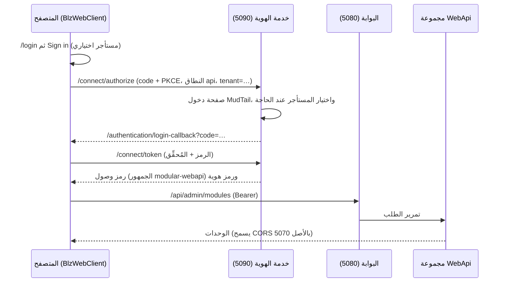

`src/apps/blazor/ModularBlazor.BlzWebClient` هو عميل Blazor WebAssembly لمنصة WebApi. وهو يحل محل
`ModularBlazor.Client` الذي يخاطب المشروع المتقادم `api/ModularBlazor.Host`. يحتفظ بنظام الوحدات في العميل القديم
(الكتالوج والمحمل والتخطيطات والموجه)، ويغير ثلاثة أشياء:

| | `ModularBlazor.Client` (القديم) | `ModularBlazor.BlzWebClient` |
| --- | --- | --- |
| تسجيل الدخول | نموذج كلمة مرور (Module.Auth) يرسل إلى Host؛ ويحفظ JWT في التخزين المحلي | OpenID Connect مع خدمة الهوية OpenIddict: Authorization Code مع PKCE |
| كتالوج وحدات العميل | وحدة Catalog في Host (`/api/modules/core` و`/api/me/modules`) | الملف `wwwroot/module-catalog.json`، مرشحا بأدوار الرمز |
| إدارة وحدات المضيف | Module.Admin عبر `IModuleAdminApi` (‏`/api/v1/modules` في Host) | صفحة خاصة به عبر `WebApi.Client` (‏`/api/admin/modules` خلف البوابة) |
| الجداول والنماذج | HTML عادي | MudTail، من الوحدة Layouts.Default |

## التشغيل

يشغله مختبر Aspire بكل ما يحتاجه، كالمورد `blzwebclient` على المنفذ 5070، بعد جاهزية `identity` و`gateway`:

```bash
dotnet run --project src/Aspire/Hybird --launch-profile http
```

افتح `http://localhost:5070`، واختر **Sign in**، واستخدم حساب تطوير من `appsettings.Development.json` في خدمة
الهوية. يملك `admin@modular.local` الدور `platform-admin`، فيرى أيضا **Host modules** في القائمة.

ومن دون Aspire، شغل خدمة الهوية (5090) وبوابة (5080) بنفسك، ثم:

```bash
dotnet run --project src/apps/blazor/ModularBlazor.BlzWebClient
```

:::caution[إعادة البناء أثناء تشغيل المختبر]
يقرأ خادم تطوير WebAssembly قائمة الملفات الثابتة مرة واحدة عند البدء. بعد إعادة بناء العميل، أعد تشغيل المورد
`blzwebclient` من لوحة Aspire، وإلا رفض المتصفح الملفات الجديدة (فشل فحص السلامة) وبقي التطبيق على
"Loading core modules…".
:::

## الإعدادات

يعمل تطبيق WebAssembly في المتصفح ولا يقرأ متغيرات البيئة التي يضبطها Aspire، لذا توجد العناوين في
`wwwroot/appsettings.json`:

```json
{
  "Oidc": {
    "Authority": "http://localhost:5090/",
    "ClientId": "blazor-client",
    "ResponseType": "code",
    "DefaultScopes": [ "openid", "profile", "email", "api" ],
    "RedirectUri": "authentication/login-callback",
    "PostLogoutRedirectUri": "authentication/logout-callback"
  },
  "WebApi": {
    "BaseUrl": "http://localhost:5080/",
    "Pools": [ "core", "sales", "worker", "workflow" ]
  }
}
```

منفذ التطبيق جزء من تسجيله، فيجب أن تتفق معه كل هذه الإعدادات (5070 في المختبر):

| المكان | الإعداد |
| --- | --- |
| `appsettings.json` في خدمة الهوية | يحتوي `Identity:BlazorClient:RedirectUris` و`PostLogoutRedirectUris` على `http://localhost:5070/authentication/login-callback` و`.../logout-callback`. ويحدّث المُهيِّئ التطبيق `blazor-client` عند البدء |
| `appsettings.Development.json` في خدمة الهوية | يحتوي `Cors:AllowedOrigins` على `http://localhost:5070` (يستدعي المتصفح نقطة إصدار الرموز) |
| مجموعات WebApi | يحتوي `Cors:AllowedOrigins` على `http://localhost:5070`. يضبط AppHost المتغير `Cors__AllowedOrigins__0` على كل نسخة؛ وهو فارغ افتراضيا |
| AppHost | `BlzWebClientPort` و`BlzWebClientOrigin` في `src/Aspire/Hybird/AppHost.cs` |

## تسجيل الدخول



- يسجل `Auth/AuthServiceExtensions.cs` الدالة `AddOidcAuthentication` (القسم `Oidc`)، والأدوار من المطالبة `role`،
  وHttpClient باسم `WebApi`. ولا يضيف `AuthorizationMessageHandler` الرمز إلا إلى طلبات البوابة.
- ينفذ `Auth/OidcAuthenticationService.cs` الواجهة `IAuthenticationService` للوحدات. يعيد `NavigateToExternalLogin`
  و`ReLoginAsync` التوجيه إلى خدمة الهوية، وينهي `LogoutAsync` جلسة الهوية أيضا. أما `LoginAsync` بكلمة المرور من
  العميل القديم فيرمي `NotSupportedException`: تكتب كلمة المرور في صفحة خدمة الهوية، ولا تصل إلى هذا التطبيق أبدا.
- يرسل حقل المستأجر في `/login` كمعامل التفويض `tenant`، فيرتبط الرمز بذلك المستأجر. وإن ترك فارغا، يحصل المستخدم
  ذو العضوية الواحدة على مستأجره، ويختار صاحب العضويات المتعددة في خدمة الهوية، ويحصل حساب المنصة على رمز بلا مستأجر.
- يقسم `Auth/OidcClaimsPrincipalFactory.cs` مطالبة `role` التي تحمل مصفوفة JSON إلى مطالبة لكل دور، كي يعمل
  `IsInRole` و`UserInfo.Roles` لمن يملك عدة أدوار.
- لا يرسل الموجه `/authentication/{action}` (‏login وlogin-callback وlogout وlogout-callback) إلى صفحة الدخول أبدا،
  ويعرض تقدمه في بطاقة MudTail نفسها.

وتستخدم صفحات خدمة الهوية (الدخول، واختيار المستأجر، والخروج، والدعوات، والحساب) ورقة أنماط MudTail أيضا:
`wwwroot/css/mudtail.css`، وهي نسخة يحدثها البناء من `src/MudTail/dist` إن وجد. وتتبع الوضع الداكن للنظام.

## وحدات العميل

تأتي الوحدات من `modules/client` وتبنى مع كل بناء للعميل (تزايديا) في `wwwroot/modules`، فتقدم وتنشر كأي ملف آخر:

| الوحدة | تشحن كـ | تحمل |
| --- | --- | --- |
| `Layouts.Default` | `.dll` | عند البدء، للجميع: التخطيط الافتراضي والسمة ووقت تشغيل MudTail |
| `Module.Dashboard` | `.dll` | عند فتح `/dashboard`، للمستخدمين المسجلين |
| `Module.Reports` | `.nupkg` | عند فتح `/reports`، للمستخدمين المسجلين |
| `Module.Tenants` | `.dll` + `soft.square.net.WebApi.Modules.Core.Tenancy.Client.dll` | عند فتح `/tenants`، للدور `platform-admin` فقط |

لا تشحن هذه لأنها لا تعمل إلا مع Host القديم: `Module.Auth` (الدخول بكلمة المرور)، و`Module.Admin` (واجهة وحدات
Host)، و`Module.ToDo` (‏`/api/v1/todos`). ولتخطي بناء الوحدات استخدم `-p:BuildClientModules=false`.

يسردها الملف `wwwroot/module-catalog.json`. كل مدخل هو واصف وحدة، بالشكل نفسه الذي كان يعيده Catalog القديم، مع
`availableToRoles` اختياري:

```json
{
  "id": "Module.Reports",
  "kind": "nupkg",
  "url": "modules/soft.square.net.Module.Reports.1.0.0.nupkg",
  "requiresAuth": true,
  "routePrefixes": [ "reports" ],
  "layout": "default",
  "styles": [ "reports.css" ],
  "nav": [ { "title": "Reports", "href": "reports", "order": 20 } ],
  "availableToRoles": [ "platform-admin" ]
}
```

يقرأ `ModuleManager` الملف عند البدء ويحمل وحدات `loadOnStartup`. وبعد الدخول (وبعد إعادة التحميل والجلسة ما زالت في
المتصفح) يسجل وحدات المستخدم التي تسمح بها أدوار الرمز: المدخل الخالي من `availableToRoles` لكل مستخدم مسجل. ويزيلها
الخروج مرة أخرى. ولإضافة وحدة، أضف مشروعها إلى العناصر `ClientModuleDll` (أو `ClientModulePackage` لحزمة `.nupkg`)
في ملف csproj، ومدخلا إلى الكتالوج.

وحدة `.dll` التي تحتاج تجميعات أخرى تسردها في `extraAssemblies`، فتحمل قبل الوحدة. وتستخدمه `Module.Tenants` لعميل
Tenancy المولد، وهو عنصر `ClientModuleDll` مستقل:

```json
"url": "modules/soft.square.net.Module.Tenants.dll",
"extraAssemblies": [ "modules/soft.square.net.WebApi.Modules.Core.Tenancy.Client.dll" ]
```

`ModuleManager` و`ActiveModuleService` وخدمات المصادقة **scoped**، لأن `AuthenticationStateProvider` في OIDC كذلك.
ولـ WebAssembly نطاق واحد للتطبيق كله، و`host.Services` في `Program.cs` هو ذلك النطاق، فتبقى ما بقيت الصفحة.

## صفحات MudTail

تضم `Layouts.Default` تكامل MudTail مع Blazor في ملفها `js/module.js`، ويسلمه `moduleHost.get('Layouts.Default')`.
ولأن هذه الوحدة تحمل عند البدء وتبقى نشطة، تستخدم صفحات التطبيق نفسه وقت التشغيل والسمة نفسيهما مع الوحدات:

- يحصل `MudTailRuntime` على وقت التشغيل ويقدم `ToastAsync` و`BehaviorAsync`، ويسجله المضيف (scoped).
- يغلف `MudTailDataTable` جدول بيانات MudTail (البحث، ومرشحات الأعمدة، والفرز، والترقيم، وقائمة لكل صف). تأتي الصفوف
  من .NET عبر `SetDataAsync`، وتعود إجراءات الصفوف كـ `OnAction(action, key)`، والنقر على الصف كـ `OnRowClick(key)`
  (لا تكون الصفوف قابلة للنقر إلا إذا كان له معالج). المعرفان `edit` و`delete` خاصان بـ MudTail (نافذة التحرير والحذف
  في المتصفح) ولا يصلان أبدا إلى `OnAction`، فاستخدم معرفات أخرى.

كلاهما في `src/ModularBlazor.Abstractions/MudTail/` (فضاء الأسماء `soft.square.net.ModularBlazor.Abstractions.MudTail`)،
فتستخدم وحدات العميل الجدول نفسه الذي تستخدمه صفحات المضيف. وتستدعي الوحدة البوابة عبر
`IHttpClientFactory.CreateClient(HttpClientNames.WebApi)`، وهو HttpClient المضيف الذي يحمل رمز الوصول.
- تستخدم `/login` و`/authentication/{action}` أصناف الورقة وحقل الإدخال والأزرار في MudTail، بلا تخطيط.

| الصفحة | ما تفعله |
| --- | --- |
| `/` | وحدات العميل في جدول MudTail: النوع والاستراتيجية والوصول والمسارات والحالة. إجراءات الصف: فتح، تحميل، إعادة تحميل، إزالة (تبقى وحدات البدء محملة) |
| `/host-modules` | للدور `platform-admin` فقط. وحدات المضيف في WebApi، من البوابة أو من مجموعة واحدة (`/pools/{pool}/…`): معلومات المجموعة، ورفع حزمة وتثبيتها، ثم التفعيل والتعطيل والإزالة من الذاكرة وإلغاء التثبيت وتحرير الإعدادات |
| `/login` | الدخول (مستأجر اختياري)، أو المتابعة والخروج لمن دخل بالفعل |
| `/tenants` | الوحدة `Module.Tenants`، للدور `platform-admin` فقط. المستأجرون مع الخطة الحالية وآخر يوم والأيام المتبقية و"يحتاج انتباها" (ينتهي خلال 7 أو 30 أو 90 يوما). إنشاء مستأجر (وهذا ينشئ قاعدة بياناته أيضا)، ولكل صف: الاشتراكات، والتحرير (الاسم والمضيفات)، والتفعيل، والإيقاف، وإصلاح قاعدة البيانات. والنقر على الصف يفتح المستأجر |
| `/tenants/{id}` | مستأجر واحد: تفعيله أو إيقافه، وفترات اشتراكه. إضافة فترة (أول يوم، آخر يوم، الخطة، ملاحظات)، أو تمديد فترة إلى آخر يوم أبعد، أو إلغاؤها مع سبب (وتبقى في السجل) |

## المستأجرون والاشتراكات

تستدعي `Module.Tenants` الوحدة الأساسية Tenancy (‏`/api/tenancy/...` على مجموعة core، عبر البوابة) بعميلها المولد،
وتحتاج صلاحية المنصة `platform.tenants.manage`، وهي للدور `platform-admin`.

الاشتراكات **للعلم فقط**: حين تنتهي فترة لا يحدث شيء تلقائيا. تعرض التواريخ ويبلغ عنها، ويوقف المدير المستأجر يدويا
إن كان يجب أن يفقد الوصول. وترفض طلبات المستأجر الموقوف حتى يفعل مجددا.

تغطي الفترة `[StartsAt, EndsAt)`. تطلب الصفحة آخر يوم شاملا وترسل `EndsAt` = اليوم التالي له، الساعة 00:00 UTC. ولا
يجوز تداخل الفترات (409)، ولا يمد التمديد النهاية إلا إلى وقت أبعد، وتحتفظ الفترة الملغاة بمن ألغاها ولماذا. وتبدأ
الفترة الجديدة افتراضيا في اليوم التالي لآخر فترة غير ملغاة (أو اليوم) وتمتد سنة واحدة.

## إدارة وحدات المضيف

يبني `Services/HostModulesApi.cs` العملاء المولدين في [`WebApi.Client`](/backend/create-a-module/#the-hosts-own-client-module-management)
على HttpClient باسم `WebApi`: ‏`ModulesClient` و`PoolClient` و`HealthClient`. ومن دون مجموعة يمر الطلب عبر المسار
الشامل للبوابة إلى مجموعة core. ومع مجموعة يصبح العنوان الأساسي `/pools/{pool}/`، وهو مسار بوابة المختبر إلى مجموعة
واحدة. وكتالوج الوحدات مشترك وتغييرات دورة الحياة تبث للجميع، فتصل كل المجموعات إلى الحالة نفسها أيا كانت التي
استدعيتها.

تحتاج نقاط النهاية صلاحية المنصة `platform.modules.manage`، وهي للدور `platform-admin`. وتعرض الأخطاء كرسائل: تفاصيل
ProblemDetails، أو 401 (سجل الدخول مجددا)، أو 403 (لا صلاحية)، أو "البوابة غير متاحة" حين يفشل الطلب قبل أن يصل رد
(البوابة متوقفة، أو الأصل غير موجود في `Cors:AllowedOrigins`).

## ما تحقق في المختبر

| الفحص | النتيجة |
| --- | --- |
| البدء | تحمل Layouts.Default قبل أول عرض؛ وتعرض الصفحة الرئيسية جدول MudTail |
| الدخول | ‏`/login` ← صفحة دخول خدمة الهوية (MudTail) ← رد النداء ← الدخول كمدير المنصة؛ وتظهر وحدات المستخدم |
| إعادة التحميل | تبقى الجلسة بعد إعادة تحميل الصفحة؛ والرابط المباشر إلى `/dashboard` ينزل Module.Dashboard |
| وحدة `.nupkg` | يحمل `/reports` الوحدة Module.Reports وورقة أنماطها من الحزمة |
| وحدات المضيف | تأتي القائمة عبر البوابة بالرمز (ويمر CORS)؛ ويعرض التبديل إلى مجموعة sales تلك المجموعة؛ ويغير تعطيل `inventory` وتفعيله مساراته من 4 إلى 0 ثم يعيدها |
| المستأجرون | يسرد `/tenants` المستأجرين acme وglobex مع تقرير الاشتراكات؛ ويعمل التحرير والإيقاف والتفعيل وإصلاح قاعدة البيانات؛ ويرفض إنشاء `acme` مرة أخرى (409) |
| الاشتراكات | في `/tenants/globex`: تضاف فترة سنة، وترفض فترة متداخلة (409)، وتمدد الفترة سنة ثم تلغى مع سبب، وتبقى في السجل |
| الخروج | ينهي جلسة الهوية ويعود إلى `/login` |
