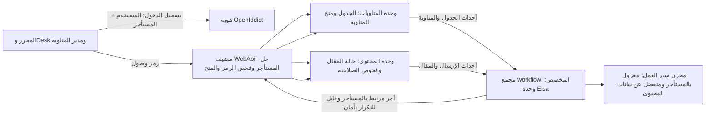

:::caution[الحالة]
تسجل هذه الصفحة تصميم التكامل الموصى به. لم ينفذ بعد في مضيف WebApi الجديد ذي وحدات التشغيل.
يحتوي `ModularBlazor.Host` الأقدم على مضيف Elsa مضمّن؛ راجع [حالة المستودع](#حالة-المستودع).
:::

## التوصية

شغّل Elsa في **مجمع `workflow` مخصص**: عمليات WebApi مستقلة تحمّل وحدة تشغيل Elsa الموثوقة وحدها. اضبط `HotUnload = false`، ورقّ التحديثات بإعادة تشغيل متتابعة للمجمع. هذه هي الاستراتيجية المختارة. تعامل مع Elsa كمحرك لسير العمل ومنسق للمؤقتات، لا كمالك لبيانات غرفة الأخبار أو لصلاحياتها.

- **خدمة الهوية** تصادق على المستخدمين وتصدر رمزا لمستأجر واحد.
- **مضيف WebApi** يحل المستأجر ويتحقق منه، ثم يفرض الصلاحيات والمنح المحددة النطاق.
- **وحدة المناوبات** تملك الأقسام والجداول وتسجيل الدخول والخروج، وتنتج المنح الزمنية من جدول المناوبة.
- **وحدة المحتوى** تملك الأعمال الإبداعية (المقالات والأخبار ومقاطع الفيديو والتقارير المصورة وغيرها)، وتتحقق من كل انتقال حالة أو إسناد أو تعديل أو إعادة أو نشر.
- **Elsa** تنسق الخطوات والمؤقتات الدائمة، ثم تطلب من الوحدة المالكة تنفيذ التغيير عبر API أو رسالة مصادق عليها.

يبقي هذا التصميم ملكية المجال واضحة، ولا يجعل المؤقت أو تعطل Elsa هو الحد الأمني. لا يمنح المضيف الوصول إلا بعد فحص المستأجر ونافذة الوقت ونطاق المورد الحالي.

## قرار النشر: مجمع workflow مخصص

يتبع النشر المختار استراتيجية وحدة التشغيل الأصلية: يشغّل Aspire مجموعة عمليات WebApi مستقلة لمجمع `workflow`، وتحمل هذه العمليات وحدة Elsa الموثوقة وحدها. لا تحمّل Elsa في مجمعات core أو sales أو worker. عطّل التفريغ الساخن، وانشر تحديث الوحدة بإعادة تشغيل متتابعة لنسخ مجمع workflow.

هذا **عزل على مستوى العملية** عن مجمعات WebApi الأخرى، وليس ملف تنفيذ Elsa مستقلا. تعمل Elsa داخل عملية مضيف WebApi لكل نسخة من مجمع workflow، مستخدمة محمل الوحدات وخط المعالجة الفرعي الخاص بواجهة Elsa وStudio. وتظل طلبات المستخدم والإجراءات المؤجلة تعبر حدود الخدمات إلى مجمعي المحتوى والمناوبات؛ فلا تصل وحدة Elsa إلى الخدمات أو قواعد البيانات الموجودة في ذاكرة تلك المجمعات.

### ما نتنازل عنه مقارنة بخادم Elsa مستقل

| الجانب | مجمع workflow بوحدة Elsa — المختار | مشروع/عملية Elsa Server مستقلة |
| --- | --- | --- |
| عزل العمليات | معزول عن عمليات core وsales وworker لأنه في مجمع مستقل. | معزول أيضا؛ ولا يضيف عزلا بين المجمعات يتجاوز الاستراتيجية المختارة. |
| النشر والإصدارات | يستخدم صورة مضيف WebApi وعقد الوحدة ومسار الإصدار نفسه. ويتطلب `HotUnload = false` إعادة تشغيل متتابعة للمجمع عند تحديث الوحدة. | يمكن إصدار وتحديث مضيف Elsa وWebApi بشكل مستقل، مع مساري بناء ونشر منفصلين. |
| استضافة Elsa | يجب دمج خدمات Elsa المستضافة ومساراتها مع دورة حياة الوحدة وخط معالجة فرعي خاص. وهذه أكبر كلفة تقنية وتحتاج إلى تجربة تكامل. | يستخدم مضيف ASP.NET Core الخاص بـElsa وإعداداته الأصلية للوسيط والمسارات، بلا خط وحدة فرعي في WebApi. |
| توافق الاعتمادات والإصدارات | تشترك حزم Elsa في شجرة اعتمادات مضيف WebApi داخل عملية workflow، ويجب توافقها مع إصدارات .NET وASP.NET Core وعقود الوحدات. لا تتأثر المجمعات الأخرى، لكن مضيف workflow ووحدة Elsa مرتبطان. | اعتمادات Elsa ودورة تحديثها مستقلتان عن حزم مضيف WebApi. |
| البنية والتشغيل | يعيد استخدام أنماط Aspire والمجمعات وإعدادات الصحة والقياس ومحول المضيف الواعي بالمستأجر ونموذج نشر الوحدات الحالي. | يضيف تطبيقا وصورة وإعدادات ومسار نشر وفحوص صحة وقياس وتوجيه وهوية خدمة وأسرارا إضافية. |
| التكامل بين العمليات | مطلوب على أي حال: تستدعي Elsa واجهات المحتوى والمناوبات أو تستخدم الرسائل لأنهما في مجمعات أخرى. | مطلوب أيضا، وكذلك لأي تواصل مع WebApi. |
| التوسع | يمكن توسيع نسخ workflow مستقلا عن مجمعات API. | يمكن توسيعه مستقلا أيضا. |
| المستأجر والتفويض | نموذج المستأجر والطلبات التي يفحصها المضيف كما في هذه الصفحة. | لا يمنح ميزة أمنية تلقائية؛ يحتاج إلى تمرير المستأجر وهوية خدمة وربط الصلاحيات وفحوص المضيف نفسها. |

**التنازلات المقبولة:** نتنازل عن إصدار مضيف Elsa بشكل مستقل وعن استخدام خط ASP.NET Core أصلي على مستوى المضيف. بالمقابل نحافظ على تغليف وحدة التشغيل ومسار النشر الحاليين مع بقاء العزل والتوسع مستقلين عن المجمعات الأخرى. ولا نخلط Elsa مع مجمعات API العامة ولا نسمح بتفريغها أثناء التشغيل.

نختار خادم Elsa مستقلا لاحقا فقط إذا أثبتت تجربة الوحدة أن خط المعالجة الفرعي أو دورة الخدمات المستضافة غير موثوقين، أو تعذر توافق اعتمادات Elsa مع مضيف workflow، أو احتجنا دورة إصدار منفصلة عن مضيف WebApi. تظل عقود المستأجر والرسائل والتفويض وملكية المجال كما هي في كلا الخيارين.

## حالة المستودع

يوجد في المستودع مساران معماريان مختلفان، ويجب عدم الخلط بينهما:

| الجزء | الحالة الحالية |
| --- | --- |
| `src/api/ModularBlazor.Host` الأقدم | Elsa 3.9 مضمنة بوصفها `ElsaHostModule`. تربط تعدد المستأجرين في Elsa بـFinbuckle وتخزن سير العمل في قاعدة مشتركة مع معرّف مستأجر Elsa. محول الصلاحيات فيها يتبع نموذج التفويض القديم. |
| مضيف وحدات التشغيل الجديد في `src/WebApi` | يحتوي خدمة هوية OpenIddict مستقلة ووحدة مناوبات واعية بالمستأجر. لا يستضيف Elsa بعد ولا يحتوي مشروع وحدة تشغيل لها. |

يبرهن `FinbuckleTenantResolver` الأقدم على نمط المحول المفيد: يأخذ المستأجر الذي حله المضيف ويمرر معرّفه إلى Elsa. في المضيف الجديد، اربط هذا المحول بسياق/دليل المستأجر الحالي. لا تنشئ قائمة مستأجرين ثانية مستقلة داخل Elsa. موضع النشر المتفق عليه موضح في [المصادقة والتفويض، القسم 9](/ar/backend/auth-design/).

مواضع الشيفرة ذات الصلة: `ElsaHostModule.cs` و`FinbuckleTenancy.cs` في المضيف القديم، و`ShiftsModule.cs` و`TokenIssuer.cs` في تطبيق WebApi الجديد.

## تمرير المستأجر وعزل البيانات

يجب التعامل مع سياقين للمستأجر:

1. **طلب HTTP:** يحل مضيف WebApi المستأجر من سياق الطلب الموثوق ويتأكد من مطابقته لمطالبة `tenant` الموقعة في الرمز. وتحتاج طلبات API الخاصة بـElsa إلى مصادقة وحل مستأجر مكافئين.
2. **تنفيذ سير العمل المؤجل:** قد لا يوجد طلب HTTP الأصلي. احفظ معرّف المستأجر ومعرّفات المجال في مثيل سير العمل. عند استئناف Elsa، تحقّق من المستأجر في دليل المنصة وأنشئ نطاق خدمات صريحا مرتبطا به قبل تنفيذ الخطوة التالية.

لا تثق بمعرّف مستأجر موجود فقط في جسم رسالة أو ترويسة يتحكم بها المستدعي. صادق على عملية Elsa وقيّدها بمجموعة مستأجرين صريحة أو بهوية خدمة مرتبطة بمستأجر. احتفظ بمعرّف المستخدم الذي بدأ العملية للتدقيق، لكن لا تعتبر رمز مستخدم قديم تفويضا صالحا لمؤقت يعمل لاحقا.

استخدم قاعدة بيانات ومخططا مخصصين لسير عمل Elsa ومنفصلين عن قواعد محتوى المستأجرين. يمكن أن تكون على خادم PostgreSQL نفسه المستخدم لقواعد المنصة. وهذا تشديد للتوجيه الأصلي «مخطط PostgreSQL خاص به» بعزل ترحيلات Elsa ونسخها الاحتياطية على مستوى قاعدة البيانات. يمكن لقاعدة سير عمل مشتركة خدمة SaaS إذا كان كل مخزن دائم أو مساعد في Elsa واعيا بالمستأجر وتم التحقق من العزل للإصدار المستخدم. كما يمنع ذلك ربط تخزين Elsa بمحركات قواعد البيانات المتعددة لبيانات أعمال المستأجرين. ويمكن للنشر المخصص أن يستخدم قاعدة Elsa خاصة بالعميل.

تفصل وثائق Elsa بين حل المستأجر وعزل التخزين، وتنبه إلى أن بعض المخازن قد لا تطبق تصفية المستأجر. تحقق من كل مخزن وكل نشاط مخصص قبل تفعيل مستأجر. [إعداد تعدد المستأجرين في Elsa](https://docs.elsaworkflows.io/multitenancy/setup.md)

## المصادقة والتفويض

- أبق **OpenIddict Identity** جهة الهوية الوحيدة للمستخدمين. لا تنشئ قاعدة مستخدمين ثانية لـElsa ولا تنسخ إليها أدوار الصحف أو الفئات أو المناوبات.
- تبقى رموز المستخدم مرتبطة بمستأجر واحد وتحمل مطالبات هوية ثابتة مثل `sub` و`tenant`. أما نطاقات الصحف والفئات ومنح المناوبات فتبقى على الخادم ويفحصها المضيف وقت الطلب.
- صادق على عملية Elsa بوصفها خدمة. يجب ربط أوامرها المؤجلة بمستأجر محدد وأن تكون محدودة الصلاحية وقابلة للتدقيق. نفّذ عقد رموز الخدمة قبل تفعيل الأوامر بين العمليات.
- احم API إدارة Elsa بصلاحيات إدارة سير عمل محدودة. صلاحيات API الخاصة بـElsa لا تستبدل صلاحيات التطبيق، ولا تحمي تلقائيا مسارات سير العمل التي أنشأها نشاط HTTP. [مصادقة Elsa وتفويضها](https://docs.elsaworkflows.io/guides/authentication.md)
- لا تستخدم صلاحية شاملة `*` للمحررين أو مستخدمي Desk العاديين. في المضيف القديم، تمنح `ElsaPermissionTransformation` صلاحيات سير عمل عامة بناء على فحص دور بسيط؛ وهذا أوسع من سياسة غرفة الأخبار المحددة النطاق.

### نطاق الصحيفة والفئة

تخزن وحدة المناوبات الحالية معرّفات الفئات فقط، وتكتب منحا بنطاق مثل `category:{id}`. لكن متطلبات غرفة الأخبار تسمح للقسم بأن يغطي فئات من صحف متعددة. لذلك إما أن تكون معرّفات الفئات فريدة على مستوى الشركة ويُفرض هذا الشرط، أو أن يتضمن النطاق معرّفي الصحيفة والفئة، مثل `press:{pressId}:category:{categoryId}`. ويجب أن تفوض وحدة المحتوى باستخدام الزوج نفسه. يظل المستأجر الحد الخارجي في الحالتين.

## حدود سير العمل

لسير عمل غرفة الأخبار:

- بعد قبول مدير المناوبة للإرسال، يمكن لـElsa بدء مهلة الإسناد التلقائي القابلة للضبط (خمس دقائق افتراضيا). يفوز إسناد المدير إذا تم قبل انتهاء المؤقت؛ وإلا تطلب Elsa الإسناد التلقائي من واجهة تطبيق المحتوى/المناوبات. لا تقبل Elsa الإرسال نيابة عن المدير؛ بل تذكره إذا ظل الإرسال بلا قبول.
- تظل وحدة المناوبات المرجع لجدول المناوبات والخروج. يمكن لـElsa جدولة إجراء مهلة الخروج (15 دقيقة افتراضيا)، لكن المضيف ينهي المنح وفقا لساعة المناوبة حتى عند تعطل Elsa. عند انتهاء المهلة، تنهي Elsa المناوبة وتنقل العمل غير المكتمل إلى قائمة المناوبة التالية؛ أما عند الخروج المبكر فيختار المدير ما سينقل.
- يمكن لمستخدم Desk أو مدير المناوبة إعادة العمل وفق منح المستأجر والمناوبة والفئة الحالية. تنفذ وحدة المحتوى الإعادة وتسجل انتقال الحالة.
- تظل قواعد النشر المجدول والتعديلات بعد النشر وإعادة الموافقة ملكا لوحدة المحتوى. أي تعديل لاحق يلغي موعد النشر المعلق، ويبقي النسخة المنشورة الحالية متاحة، ويرسل النسخة المعدلة لموافقة Desk من جديد. يمكن لـElsa تنسيق الإجراء المجدول، لكنها لا تتجاوز تفويض المحتوى أو فحوص حالته.

يجب أن يكون كل أمر **قابلا للتكرار بأمان** عند إعادة المحاولة أو التنافس. مثلا، يجب ألا يستبدل الإسناد التلقائي إسنادا نفذه المدير قبل ثوان. استخدم نمط Outbox للمعاملات لنشر أحداث المجال إلى Elsa، واجعل الجهة المستقبلة تزيل التكرارات. لا تخزن نص المقال داخل متغيرات سير العمل؛ احفظ المعرّفات والحد الأدنى اللازم للاستئناف فقط.

## شكل التكامل

1. أضف مجمع `workflow` مخصصا إلى Aspire وحمّل فيه وحدة تشغيل Elsa الموثوقة وحدها. لا تضع وحدات أخرى في المجمع، وعطّل التفريغ الساخن، وحدّثه بإعادة تشغيل متتابعة.
2. جهز الوحدة بفحوص صحة وتخزين لسير العمل واعٍ بالمستأجر وخط API فرعي خاص. أضف محول تكامل رفيعا للأحداث المرتبطة بالمستأجر والأوامر المحددة والمصادق عليها.
3. احفظ `TenantId` ومعرّفات المناوبة/المقال ومفاتيح الارتباط ومنع التكرار وإصدار سير العمل والفاعل الذي بدأه ضمن سياق سير العمل الدائم.
4. مرر كل إجراء مؤجل عبر API أو معالج أوامر الوحدة المالكة للمناوبات/المحتوى. يعيد المضيف فحص حالة المستأجر والمنح الحالية وحالة المجال وقت التنفيذ. اربط صلاحيات تصميم/تشغيل سير العمل المحددة بمطالبات صلاحيات API الخاصة بـElsa، ولا تمنح مستخدمي غرفة الأخبار صلاحية شاملة.
5. اختبر عبور المستأجرين وتعليق المستأجر والخروج أثناء انتظار سير العمل وتسليم الرسالة مرتين والتنافس بين الإسناد اليدوي والتلقائي وإعادة التشغيل والاستعادة قبل الإنتاج.

### القرار بجملة واحدة

**تملك Elsa التنسيق والمؤقتات؛ وتملك خدمة الهوية مستخدمي المنصة وعضويات المستأجرين؛ ويملك مضيف WebApi التفويض؛ وتملك المناوبات جدولها؛ ويملك المحتوى المقالات وحالاتها.**
