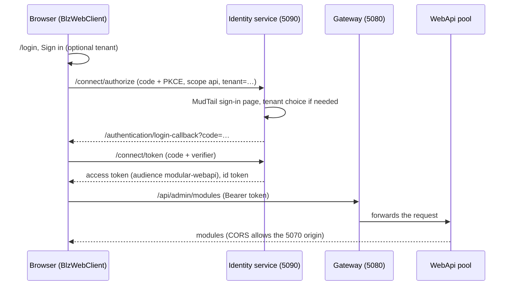
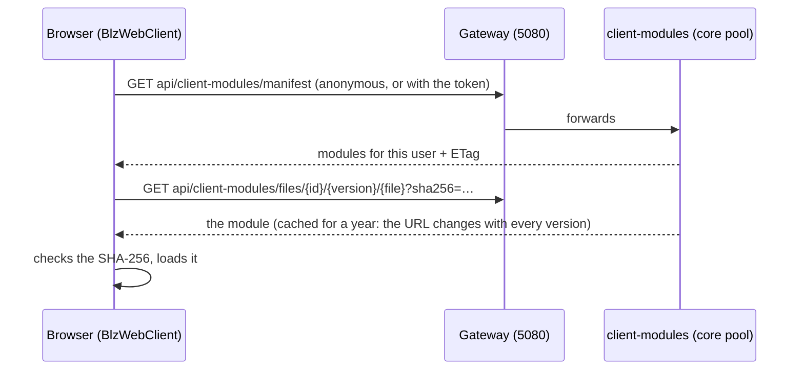

`src/apps/blazor/ModularBlazor.BlzWebClient` is the Blazor WebAssembly client of the WebApi platform. It replaces
`ModularBlazor.Client`, which talks to the obsolete `api/ModularBlazor.Host`. It keeps the old client's module system
(catalog, loader, layouts, router), and changes three things:

| | `ModularBlazor.Client` (old) | `ModularBlazor.BlzWebClient` |
| --- | --- | --- |
| Sign-in | Password form (Module.Auth) posting to the Host; JWT kept in local storage | OpenID Connect against the OpenIddict identity service: Authorization Code with PKCE |
| Client module catalog | The Host's Catalog module (`/api/modules/core`, `/api/me/modules`) | The WebApi's client-modules core module (`/api/client-modules/manifest`), filtered per user on the server |
| Host module management | Module.Admin over `IModuleAdminApi` (the Host's `/api/v1/modules`) | Its own page over `WebApi.Client` (`/api/admin/modules` behind the gateway) |
| Tables and forms | Plain HTML | MudTail, from the Layouts.Default module |

## Run it

The Aspire lab starts it with everything it needs, as the `blzwebclient` resource on port 5070, after `identity` and
`gateway` are ready:

```bash
dotnet run --project src/Aspire/Hybird --launch-profile http
```

Open `http://localhost:5070`, choose **Sign in**, and use a dev account from the identity service's
`appsettings.Development.json`. `admin@modular.local` has the `platform-admin` role, so it also sees
**Host modules** and **Client modules** in the menu.

Without Aspire, run the identity service (5090) and a gateway (5080) yourself, then:

```bash
dotnet run --project src/apps/blazor/ModularBlazor.BlzWebClient
```

:::caution[Rebuilding while the lab runs]
The WebAssembly dev server reads the list of static files once, at start. After you rebuild the client, restart the
`blzwebclient` resource in the Aspire dashboard, or the browser rejects the new files (integrity check failed) and
the app stays on "Loading core modules…".
:::

## Configuration

A WebAssembly app runs in the browser and cannot read Aspire's environment variables, so the addresses are in
`wwwroot/appsettings.json`:

```json
{
  "Oidc": {
    "Authority": "http://localhost:5090/",
    "ClientId": "blazor-client",
    "ResponseType": "code",
    "DefaultScopes": [ "openid", "profile", "email", "api" ],
    "RedirectUri": "authentication/login-callback",
    "PostLogoutRedirectUri": "authentication/logout-callback"
  },
  "WebApi": {
    "BaseUrl": "http://localhost:5080/",
    "Pools": [ "core", "sales", "worker", "workflow" ]
  }
}
```

The port of the app is part of its registration, so all of these must agree with it (5070 in the lab):

| Where | Setting |
| --- | --- |
| Identity service `appsettings.json` | `Identity:BlazorClient:RedirectUris` and `PostLogoutRedirectUris` contain `http://localhost:5070/authentication/login-callback` and `.../logout-callback`. The seeder updates the `blazor-client` application on start |
| Identity service `appsettings.Development.json` | `Cors:AllowedOrigins` contains `http://localhost:5070` (the browser calls the token endpoint) |
| WebApi pools | `Cors:AllowedOrigins` contains `http://localhost:5070`. The AppHost sets `Cors__AllowedOrigins__0` on every replica; it is empty by default |
| AppHost | `BlzWebClientPort` and `BlzWebClientOrigin` in `src/Aspire/Hybird/AppHost.cs` |

## Sign-in



- `Auth/AuthServiceExtensions.cs` registers `AddOidcAuthentication` (section `Oidc`), roles from the `role` claim, and
  the `WebApi` HttpClient. Its `AuthorizationMessageHandler` adds the token only to requests for the gateway.
- `Auth/OidcAuthenticationService.cs` implements `IAuthenticationService` for modules. `NavigateToExternalLogin` and
  `ReLoginAsync` redirect to the identity service, and `LogoutAsync` ends the identity session too. The password
  `LoginAsync` of the old client throws `NotSupportedException`: the password is typed on the identity service's
  page, never in this app.
- The tenant field on `/login` is sent as the `tenant` authorization parameter, so the token is bound to that tenant.
  Left empty, a user with one membership gets that tenant, a user with several chooses on the identity service, and a
  platform account gets a token without a tenant.
- `Auth/OidcClaimsPrincipalFactory.cs` splits a `role` claim that holds a JSON array into one claim per role, so
  `IsInRole` and `UserInfo.Roles` work for users with several roles.
- `/authentication/{action}` (login, login-callback, logout, logout-callback) is never sent to the login page by the
  router, and shows its progress in the same MudTail card.

The identity service's own pages (sign-in, tenant choice, sign-out, invitations, account) use MudTail's stylesheet
as well: `wwwroot/css/mudtail.css`, a copy that the build refreshes from `src/MudTail/dist` when that exists. They
follow the system's dark mode.

## Client modules

The app ships no modules. The WebApi's **client-modules** core module (`/api/client-modules` on the core pool,
through the gateway) owns them: it stores every version, applies each module's settings, and tells each user which
modules they get.



**The manifest.** `ModuleManager` asks for it before the first render (anonymously, or with the token of a session
that is still in the browser), again on sign-in and sign-out, and at most once a minute on navigation. With the
`ETag` an unchanged list costs a 304. The server filters it: enabled modules, the user's roles (`requiresAuth`,
`requiredRole`, `availableToRoles`), the token's tenant (`availableToTenants`), and the modules they depend on. A
module that leaves the list is unloaded; a newer version of a loaded one shows "update available" and a toast.

**When a module loads** is its `loadStrategy`:

| Strategy | Loaded |
| --- | --- |
| `Startup` | Before the first render (layouts, the MudTail theme). Stays loaded |
| `Lazy` | When a page under one of its `routePrefixes` is opened (the default) |
| `Preload` | In the background, as soon as the manifest lists it |

Each file is checked against the SHA-256 in its URL and kept in the browser's cache, so it is downloaded again only
for a new version. The anonymous manifest is kept too: when the WebApi cannot be reached, a browser that has been
here before still starts with its layout, and the home page says "WebApi not reachable".

**Shipped with the WebApi.** The WebApi build builds these from `modules/client` into `CoreClientModules/` in its
build and publish output (`BuildCoreClientModules` in `src/WebApi/WebApi/WebApi.csproj`):

| Module | Shipped as | Loaded |
| --- | --- | --- |
| `Layouts.Default` | `.dll` | Startup, for everyone: the default layout, the theme and the MudTail runtime |
| `Module.Dashboard` | `.dll` | Lazy, `/dashboard`, signed-in users |
| `Module.Reports` | `.nupkg` | Lazy, `/reports`, signed-in users |
| `Module.Tenants` | folder: `.dll` + `soft.square.net.WebApi.Modules.Core.Tenancy.Client.dll` | Lazy, `/tenants`, `platform-admin` only |
| `Module.Admin` | `.dll` | Lazy, `/admin`, `platform-admin` only; pulls in `Layouts.Admin` |
| `Layouts.Admin` | `.dll` | With `Module.Admin` (its dependency): the `admin` layout |

On startup the core module seeds them as **core** modules, with the settings of each one's `[assembly: ClientModule]`.
A new build with other files becomes the active version; an admin's settings are kept. A `.nupkg` is compared by its
content, so packing the same code again is not a new version. Skip the module build with
`-p:BuildClientModules=false`.

To ship another module, add a `CoreClientModule` item to `WebApi.csproj`: plain for a `.dll`, `Pack="true"` for a
`.nupkg` (the project sets `PackageId`), or the same `Folder="<name>"` on every assembly of a module that needs
private assemblies (like `Module.Tenants` and its generated client). Not shipped, because they only work with the old
Host: `Module.Auth` and `Module.ToDo`.

`ModuleManager`, `ActiveModuleService` and the auth services are **scoped**, because the OIDC
`AuthenticationStateProvider` is scoped. WebAssembly has one scope for the whole app, and `host.Services` in
`Program.cs` is that scope, so they still live as long as the page.

## Client module management

`/client-modules` (menu **Client modules**, `platform-admin`) manages the catalog with the generated
`WebApi.Modules.Core.ClientModules.Client`. The endpoints need `platform.modules.manage`.

1. **Upload** a `.dll` with `[assembly: ClientModule]`, a `.nupkg`, or a `.zip` of the module and its private
   assemblies (an optional `client-module.json` in the zip overrides the attribute's settings). The file is read,
   never run: the page shows the id, version, files, pages, layouts and warnings, and whether that version is
   installed already. A WebApi (server) module is refused.
2. **Install** with the settings form (prefilled from the attribute, or the module's current settings): load
   strategy, roles, tenants, route prefixes, dependencies, styles, scripts and the menu entry. Choose whether it
   becomes the active version. Installing the same version with other files needs **Replace**; otherwise raise the
   version. Or **Discard** the upload (it expires after an hour anyway).
3. In the table: **Settings**, **Versions** (activate an older one to roll back, delete one that is not active),
   **Enable** / **Disable** (a disabled module leaves every user's list), and **Delete**.

Core modules can be reconfigured, disabled and rolled back, but not deleted or replaced by an upload: they come with
the WebApi release. After every change the page fetches the manifest again, so your own menu follows at once;
other users get the change on their next check.

| Endpoint | |
| --- | --- |
| `GET /api/client-modules/manifest` | Anonymous allowed; the modules for the caller, `ETag` / `If-None-Match` |
| `GET /api/client-modules/files/{id}/{version}/{file}` | Anonymous allowed for public modules; the others need a user the module is for |
| `GET /api/client-modules/modules`, `GET …/modules/{id}` | The catalog |
| `POST /api/client-modules/uploads` (form field `package`) | Upload and inspect; returns a token |
| `GET` / `DELETE /api/client-modules/uploads/{token}` | The upload, or discard it |
| `POST /api/client-modules/uploads/{token}/install` | `{ settings?, activate, replace }` |
| `PUT /api/client-modules/modules/{id}/settings` | Replace the settings |
| `POST …/modules/{id}/enable`, `POST …/modules/{id}/disable` | |
| `POST …/modules/{id}/versions/{version}/activate`, `DELETE …/versions/{version}` | |
| `DELETE /api/client-modules/modules/{id}` | Not for core modules, nor for a module others depend on (409) |

The catalog is `client-modules.json` and the files under `ClientModules:Path` (default `App_Data/client-modules`),
shared by the replicas of the pool. Uploads are limited to `ClientModules:MaxPackageMegabytes` (50).

## MudTail pages

`Layouts.Default` bundles MudTail's Blazor interop into its `js/module.js`, and `moduleHost.get('Layouts.Default')`
hands it out. Because that module loads at startup and stays active, the app's own pages use the same runtime and
theme as the modules:

- `MudTailRuntime` gets the runtime and offers `ToastAsync` and `BehaviorAsync`. The host registers it (scoped).
- `MudTailDataTable` wraps MudTail's data table (search, column filters, sorting, paging, a row menu). Rows come
  from .NET with `SetDataAsync`, row actions come back as `OnAction(action, key)`, and a row click as
  `OnRowClick(key)` (rows are clickable only when it has a handler). The action ids `edit` and `delete` are MudTail's
  own (its edit dialog and a delete in the browser) and never reach `OnAction`, so use other ids.

Both live in `src/ModularBlazor.Abstractions/MudTail/` (namespace `soft.square.net.ModularBlazor.Abstractions.MudTail`),
so client modules use the same table as the host's pages. A module calls the gateway with
`IHttpClientFactory.CreateClient(HttpClientNames.WebApi)`, the host's HttpClient that carries the access token.
- `/login` and `/authentication/{action}` use MudTail's paper, input control and button classes, without a layout.

| Page | What it does |
| --- | --- |
| `/` | The client modules in a MudTail table: kind, strategy, access, routes, state. Row actions: open, load, reload, unload (startup modules stay loaded) |
| `/client-modules` | `platform-admin` only. The client module catalog on the WebApi: upload and install a `.dll`, `.nupkg` or `.zip`, edit settings, switch or delete versions, enable, disable, delete (see [Client module management](#client-module-management)) |
| `/admin`, `/admin/members` | `Module.Admin`, `platform-admin` only, in the `admin` layout: the administration overview, and the members of a tenant (see [Administration](#administration)) |
| `/host-modules` | `platform-admin` only. The WebApi host modules, from the gateway or from one pool (`/pools/{pool}/…`): pool facts, upload and install a package, then activate, deactivate, unload, uninstall and edit settings |
| `/login` | Sign in (optional tenant), or continue and sign out when already signed in |
| `/tenants` | `Module.Tenants`, `platform-admin` only. The tenants with their current plan, last day, days left and "needs attention" (ending within 7, 30 or 90 days). Create a tenant (this also creates its database), and per row: subscriptions, edit (name, hosts), activate, suspend, repair database. A row click opens the tenant |
| `/tenants/{id}` | One tenant: activate or suspend it, and its subscription periods. Add a period (first day, last day, plan, notes), extend one to a later last day, or cancel one with a reason (it stays in the history) |

## Tenants and subscriptions

`Module.Tenants` calls the Tenancy core module (`/api/tenancy/...` on the core pool, through the gateway) with its
generated client, and needs the platform permission `platform.tenants.manage`, which `platform-admin` has.

Subscriptions are **informational**: when a period ends, nothing happens by itself. The dates are shown and
reported, and an admin suspends the tenant by hand when it should lose access. A suspended tenant's requests are
refused until it is activated again.

A period covers `[StartsAt, EndsAt)`. The page asks for an inclusive last day and sends `EndsAt` = the day after it,
at 00:00 UTC. Periods may not overlap (409), an extension can only move the end later, and a cancelled period keeps
who cancelled it and why. A new period starts by default on the day after the latest period that is not cancelled
(or today) and runs for one year.

## Administration

`Module.Admin` (menu **Administration**) and its layout `Layouts.Admin` are the admin area. Both are for
`platform-admin`: the access token carries platform roles only, so a tenant admin has no role the manifest could match.

- `/admin` is the overview: who is signed in, and cards for Members, Tenants, Client modules and Host modules. The
  `admin` layout's top bar links the same pages; Tenants and the module pages keep the default layout.
- `/admin/members` manages the members of one tenant on the identity service. The tenant list comes from the Tenancy
  core module (`GET api/tenancy/tenants`, through the gateway); a user signed in for a tenant starts on it.

| Action | Identity service call | Notes |
| --- | --- | --- |
| List | `GET /api/admin/tenants/{tenant}/members` | Email, display name in the tenant, role, status, invited and joined dates |
| Invite | `POST /api/admin/tenants/{tenant}/members` `{ email, role, displayName }` | Role `member` or `tenant-admin`. An unknown email gets an account without a password; the member is `Invited` until they accept on the identity service's Invitations page. Already a member: 409 |
| Suspend | `POST …/members/{userId}/suspend` | Also revokes the member's sessions in that tenant |
| Activate | `POST …/members/{userId}/activate` | Not for a pending invitation (409) |
| Remove | `DELETE …/members/{userId}` | Ends the membership and its sessions; the account stays |

The page calls the identity service with `IHttpClientFactory.CreateClient(HttpClientNames.Identity)`: the host
registers that client with the OIDC authority (`Oidc:Authority`) as base address and attaches the same access token
to it. The identity service allows `platform-admin`, or an active `tenant-admin` member whose token is for that
tenant, and its CORS policy (`Cors:AllowedOrigins`) must contain the app's origin.

The old Host's module management pages and the sample Users table are gone from `Module.Admin`; client and host
modules are managed on `/client-modules` and `/host-modules`.

## Host module management

`Services/HostModulesApi.cs` builds the generated clients of [`WebApi.Client`](/backend/create-a-module/#the-hosts-own-client-module-management)
on the `WebApi` HttpClient: `ModulesClient`, `PoolClient` and `HealthClient`. Without a pool the call goes through the
gateway's catch-all route to the core pool. With a pool, the base address becomes `/pools/{pool}/`, the lab
gateway's route to one pool. The module catalog is shared and lifecycle changes are broadcast, so every pool ends up
in the same state whichever one you call.

The endpoints need the platform permission `platform.modules.manage`, which `platform-admin` has. Errors are shown as
messages: a ProblemDetails' detail, 401 (sign in again), 403 (no permission), or "the gateway is not reachable" when
the request fails before it gets an answer (gateway down, or the origin missing from `Cors:AllowedOrigins`).

## Verified in the lab

| Check | Result |
| --- | --- |
| Startup | The anonymous manifest comes from the WebApi; Layouts.Default loads before the first render; the home page shows the MudTail table |
| Client modules | On `/client-modules`: uploading `Module.Dashboard.dll` shows its id, version, page and attribute settings; installing it adds the menu entry, and opening `/dashboard` downloads it from `api/client-modules/files/…` with its SHA-256 checked. A `.nupkg` installs the same way. Disable removes it from the menu, enable brings it back, and changing its settings (Preload, a new menu title) applies at once. The same file again is recognised as installed; a `.txt` is refused (400) |
| Shipped client modules | A WebApi build puts Layouts.Default, Dashboard, Reports and the Module.Tenants folder in `CoreClientModules/`; the first start seeds all four, anonymous callers get only the layout, and a restart after packing again seeds nothing |
| Sign-in | `/login` → identity service sign-in page (MudTail) → callback → signed in as the platform admin; the user modules appear |
| Reload | The session survives a page reload; a deep link to `/dashboard` downloads Module.Dashboard |
| `.nupkg` module | `/reports` loads Module.Reports and its stylesheet from the package |
| Host modules | The list comes through the gateway with the token (CORS passes); switching to the sales pool shows that pool; deactivating and activating `inventory` changes its routes from 4 to 0 and back |
| Tenants | `/tenants` lists acme and globex with the subscription report; edit, suspend, activate and repair database work; creating `acme` again is refused (409) |
| Subscriptions | On `/tenants/globex`: a one-year period is added, an overlapping one is refused (409), the period is extended by a year and then cancelled with a reason, and stays in the history |
| Sign-out | Ends the identity session and returns to `/login` |
