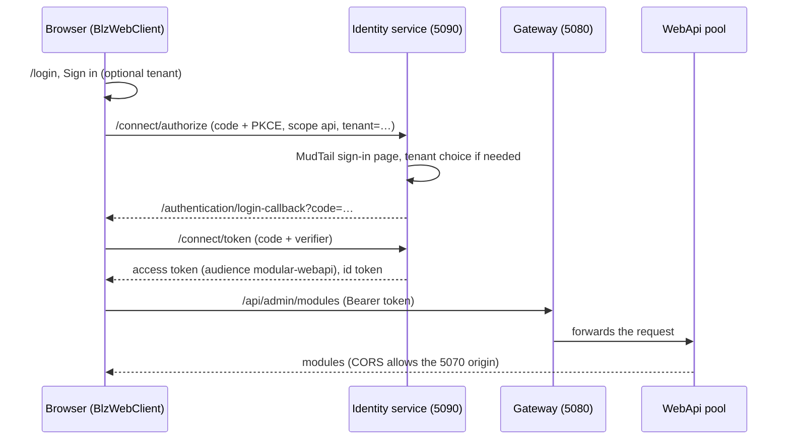

`src/apps/blazor/ModularBlazor.BlzWebClient` is the Blazor WebAssembly client of the WebApi platform. It replaces
`ModularBlazor.Client`, which talks to the obsolete `api/ModularBlazor.Host`. It keeps the old client's module system
(catalog, loader, layouts, router), and changes three things:

| | `ModularBlazor.Client` (old) | `ModularBlazor.BlzWebClient` |
| --- | --- | --- |
| Sign-in | Password form (Module.Auth) posting to the Host; JWT kept in local storage | OpenID Connect against the OpenIddict identity service: Authorization Code with PKCE |
| Client module catalog | The Host's Catalog module (`/api/modules/core`, `/api/me/modules`) | `wwwroot/module-catalog.json`, filtered by the roles in the token |
| Host module management | Module.Admin over `IModuleAdminApi` (the Host's `/api/v1/modules`) | Its own page over `WebApi.Client` (`/api/admin/modules` behind the gateway) |
| Tables and forms | Plain HTML | MudTail, from the Layouts.Default module |

## Run it

The Aspire lab starts it with everything it needs, as the `blzwebclient` resource on port 5070, after `identity` and
`gateway` are ready:

```bash
dotnet run --project src/Aspire/Hybird --launch-profile http
```

Open `http://localhost:5070`, choose **Sign in**, and use a dev account from the identity service's
`appsettings.Development.json`. `admin@modular.local` has the `platform-admin` role, so it also sees
**Host modules** in the menu.

Without Aspire, run the identity service (5090) and a gateway (5080) yourself, then:

```bash
dotnet run --project src/apps/blazor/ModularBlazor.BlzWebClient
```

:::caution[Rebuilding while the lab runs]
The WebAssembly dev server reads the list of static files once, at start. After you rebuild the client, restart the
`blzwebclient` resource in the Aspire dashboard, or the browser rejects the new files (integrity check failed) and
the app stays on "Loading core modules…".
:::

## Configuration

A WebAssembly app runs in the browser and cannot read Aspire's environment variables, so the addresses are in
`wwwroot/appsettings.json`:

```json
{
  "Oidc": {
    "Authority": "http://localhost:5090/",
    "ClientId": "blazor-client",
    "ResponseType": "code",
    "DefaultScopes": [ "openid", "profile", "email", "api" ],
    "RedirectUri": "authentication/login-callback",
    "PostLogoutRedirectUri": "authentication/logout-callback"
  },
  "WebApi": {
    "BaseUrl": "http://localhost:5080/",
    "Pools": [ "core", "sales", "worker", "workflow" ]
  }
}
```

The port of the app is part of its registration, so all of these must agree with it (5070 in the lab):

| Where | Setting |
| --- | --- |
| Identity service `appsettings.json` | `Identity:BlazorClient:RedirectUris` and `PostLogoutRedirectUris` contain `http://localhost:5070/authentication/login-callback` and `.../logout-callback`. The seeder updates the `blazor-client` application on start |
| Identity service `appsettings.Development.json` | `Cors:AllowedOrigins` contains `http://localhost:5070` (the browser calls the token endpoint) |
| WebApi pools | `Cors:AllowedOrigins` contains `http://localhost:5070`. The AppHost sets `Cors__AllowedOrigins__0` on every replica; it is empty by default |
| AppHost | `BlzWebClientPort` and `BlzWebClientOrigin` in `src/Aspire/Hybird/AppHost.cs` |

## Sign-in



- `Auth/AuthServiceExtensions.cs` registers `AddOidcAuthentication` (section `Oidc`), roles from the `role` claim, and
  the `WebApi` HttpClient. Its `AuthorizationMessageHandler` adds the token only to requests for the gateway.
- `Auth/OidcAuthenticationService.cs` implements `IAuthenticationService` for modules. `NavigateToExternalLogin` and
  `ReLoginAsync` redirect to the identity service, and `LogoutAsync` ends the identity session too. The password
  `LoginAsync` of the old client throws `NotSupportedException`: the password is typed on the identity service's
  page, never in this app.
- The tenant field on `/login` is sent as the `tenant` authorization parameter, so the token is bound to that tenant.
  Left empty, a user with one membership gets that tenant, a user with several chooses on the identity service, and a
  platform account gets a token without a tenant.
- `Auth/OidcClaimsPrincipalFactory.cs` splits a `role` claim that holds a JSON array into one claim per role, so
  `IsInRole` and `UserInfo.Roles` work for users with several roles.
- `/authentication/{action}` (login, login-callback, logout, logout-callback) is never sent to the login page by the
  router, and shows its progress in the same MudTail card.

The identity service's own pages (sign-in, tenant choice, sign-out, invitations, account) use MudTail's stylesheet
as well: `wwwroot/css/mudtail.css`, a copy that the build refreshes from `src/MudTail/dist` when that exists. They
follow the system's dark mode.

## Client modules

The modules come from `modules/client` and are built on every build of the client (incrementally) into
`wwwroot/modules`, so they are served and published like any other file:

| Module | Shipped as | Loaded |
| --- | --- | --- |
| `Layouts.Default` | `.dll` | At startup, for everyone: the default layout, the theme and the MudTail runtime |
| `Module.Dashboard` | `.dll` | When `/dashboard` is opened, for signed-in users |
| `Module.Reports` | `.nupkg` | When `/reports` is opened, for signed-in users |
| `Module.Tenants` | `.dll` + `soft.square.net.WebApi.Modules.Core.Tenancy.Client.dll` | When `/tenants` is opened, for `platform-admin` only |

Not shipped, because they only work with the old Host: `Module.Auth` (password sign-in), `Module.Admin` (the Host's
module API) and `Module.ToDo` (`/api/v1/todos`). Skip the module build with `-p:BuildClientModules=false`.

`wwwroot/module-catalog.json` lists them. An entry is a module descriptor, the same shape the old Catalog returned,
plus an optional `availableToRoles`:

```json
{
  "id": "Module.Reports",
  "kind": "nupkg",
  "url": "modules/soft.square.net.Module.Reports.1.0.0.nupkg",
  "requiresAuth": true,
  "routePrefixes": [ "reports" ],
  "layout": "default",
  "styles": [ "reports.css" ],
  "nav": [ { "title": "Reports", "href": "reports", "order": 20 } ],
  "availableToRoles": [ "platform-admin" ]
}
```

`ModuleManager` reads the file at startup and loads the `loadOnStartup` modules. After sign-in (and after a reload with
the session still in the browser) it registers the user modules the token's roles allow: an entry without
`availableToRoles` is for every signed-in user. Sign-out unloads them again. To add a module, add its project to the
`ClientModuleDll` (or `ClientModulePackage` for a `.nupkg`) items in the csproj and an entry to the catalog.

A `.dll` module that needs other assemblies lists them in `extraAssemblies`; they are loaded before the module.
`Module.Tenants` uses it for the generated Tenancy client, which is a `ClientModuleDll` item of its own:

```json
"url": "modules/soft.square.net.Module.Tenants.dll",
"extraAssemblies": [ "modules/soft.square.net.WebApi.Modules.Core.Tenancy.Client.dll" ]
```

`ModuleManager`, `ActiveModuleService` and the auth services are **scoped**, because the OIDC
`AuthenticationStateProvider` is scoped. WebAssembly has one scope for the whole app, and `host.Services` in
`Program.cs` is that scope, so they still live as long as the page.

## MudTail pages

`Layouts.Default` bundles MudTail's Blazor interop into its `js/module.js`, and `moduleHost.get('Layouts.Default')`
hands it out. Because that module loads at startup and stays active, the app's own pages use the same runtime and
theme as the modules:

- `MudTailRuntime` gets the runtime and offers `ToastAsync` and `BehaviorAsync`. The host registers it (scoped).
- `MudTailDataTable` wraps MudTail's data table (search, column filters, sorting, paging, a row menu). Rows come
  from .NET with `SetDataAsync`, row actions come back as `OnAction(action, key)`, and a row click as
  `OnRowClick(key)` (rows are clickable only when it has a handler). The action ids `edit` and `delete` are MudTail's
  own (its edit dialog and a delete in the browser) and never reach `OnAction`, so use other ids.

Both live in `src/ModularBlazor.Abstractions/MudTail/` (namespace `soft.square.net.ModularBlazor.Abstractions.MudTail`),
so client modules use the same table as the host's pages. A module calls the gateway with
`IHttpClientFactory.CreateClient(HttpClientNames.WebApi)`, the host's HttpClient that carries the access token.
- `/login` and `/authentication/{action}` use MudTail's paper, input control and button classes, without a layout.

| Page | What it does |
| --- | --- |
| `/` | The client modules in a MudTail table: kind, strategy, access, routes, state. Row actions: open, load, reload, unload (startup modules stay loaded) |
| `/host-modules` | `platform-admin` only. The WebApi host modules, from the gateway or from one pool (`/pools/{pool}/…`): pool facts, upload and install a package, then activate, deactivate, unload, uninstall and edit settings |
| `/login` | Sign in (optional tenant), or continue and sign out when already signed in |
| `/tenants` | `Module.Tenants`, `platform-admin` only. The tenants with their current plan, last day, days left and "needs attention" (ending within 7, 30 or 90 days). Create a tenant (this also creates its database), and per row: subscriptions, edit (name, hosts), activate, suspend, repair database. A row click opens the tenant |
| `/tenants/{id}` | One tenant: activate or suspend it, and its subscription periods. Add a period (first day, last day, plan, notes), extend one to a later last day, or cancel one with a reason (it stays in the history) |

## Tenants and subscriptions

`Module.Tenants` calls the Tenancy core module (`/api/tenancy/...` on the core pool, through the gateway) with its
generated client, and needs the platform permission `platform.tenants.manage`, which `platform-admin` has.

Subscriptions are **informational**: when a period ends, nothing happens by itself. The dates are shown and
reported, and an admin suspends the tenant by hand when it should lose access. A suspended tenant's requests are
refused until it is activated again.

A period covers `[StartsAt, EndsAt)`. The page asks for an inclusive last day and sends `EndsAt` = the day after it,
at 00:00 UTC. Periods may not overlap (409), an extension can only move the end later, and a cancelled period keeps
who cancelled it and why. A new period starts by default on the day after the latest period that is not cancelled
(or today) and runs for one year.

## Host module management

`Services/HostModulesApi.cs` builds the generated clients of [`WebApi.Client`](/backend/create-a-module/#the-hosts-own-client-module-management)
on the `WebApi` HttpClient: `ModulesClient`, `PoolClient` and `HealthClient`. Without a pool the call goes through the
gateway's catch-all route to the core pool. With a pool, the base address becomes `/pools/{pool}/`, the lab
gateway's route to one pool. The module catalog is shared and lifecycle changes are broadcast, so every pool ends up
in the same state whichever one you call.

The endpoints need the platform permission `platform.modules.manage`, which `platform-admin` has. Errors are shown as
messages: a ProblemDetails' detail, 401 (sign in again), 403 (no permission), or "the gateway is not reachable" when
the request fails before it gets an answer (gateway down, or the origin missing from `Cors:AllowedOrigins`).

## Verified in the lab

| Check | Result |
| --- | --- |
| Startup | Layouts.Default loads before the first render; the home page shows the MudTail table |
| Sign-in | `/login` → identity service sign-in page (MudTail) → callback → signed in as the platform admin; the user modules appear |
| Reload | The session survives a page reload; a deep link to `/dashboard` downloads Module.Dashboard |
| `.nupkg` module | `/reports` loads Module.Reports and its stylesheet from the package |
| Host modules | The list comes through the gateway with the token (CORS passes); switching to the sales pool shows that pool; deactivating and activating `inventory` changes its routes from 4 to 0 and back |
| Tenants | `/tenants` lists acme and globex with the subscription report; edit, suspend, activate and repair database work; creating `acme` again is refused (409) |
| Subscriptions | On `/tenants/globex`: a one-year period is added, an overlapping one is refused (409), the period is extended by a year and then cancelled with a reason, and stays in the history |
| Sign-out | Ends the identity session and returns to `/login` |
