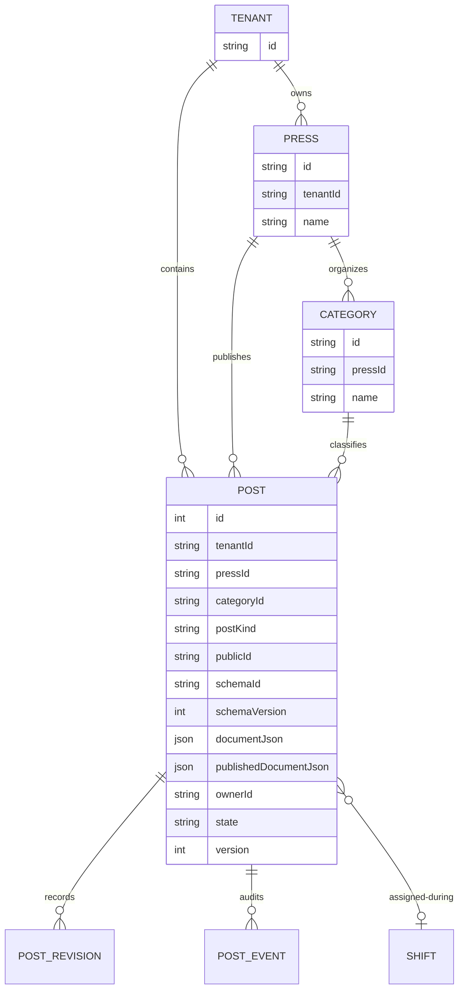

## Editorial hierarchy

The company is represented by a tenant. A tenant can own several presses; each press has its own categories. A Post is classified by exactly one press/category pair. A section in Shifts may include several such pairs, including pairs from different presses.

### Categories are not Keyword tags

The Contents module owns each press category. A category is part of the editorial domain: it determines where a Post belongs and participates in category-scoped grants, shift-section coverage, queues, and publication rules. A category ID is therefore not interchangeable with a Keyword ID.

Contents may optionally map an editorial category to a canonical Keyword concept when they represent the same subject (for example, the “Sports” category in a press may map to the shared Sports concept). That mapping helps search and SEO, but does not replace the category, grant tag access, or automatically tag every Post in the category.

Tags are separate associations from a Post to one or more Keyword concept IDs. Contents owns and persists those assignments with the Post; Keyword supplies canonical concepts and can build a searchable backlink projection. See [Keyword rules for tags, taxonomies, and categories](/modules/keyword/#rules-for-tags-taxonomies-and-categories).

## Post envelope and document

Use one Contents-owned Post aggregate. It has a stable **envelope** (identity, tenant, press, category, owner, kind, state, version, schedule, publication) and a versioned **document** that holds the post's own data. A Post may be an article, news item, video, reportage, photo story, or another approved kind. Its document may contain nested child nodes such as paragraphs, images, videos, documents or albums.

| Contents-owned envelope | Dynamic Fields-owned definition (planned) |
| --- | --- |
| Post ID, `PublicId`, tenant, press, category, owner, post kind, state, version, assignment/reviewer, schedule, published snapshot and history | The schema each node's `content` must match: nested fields, validation, conditional visibility/requiredness, reusable components and immutable versions |
| `SchemaId` and `SchemaVersion` of the document, and of every child node | The published form behind that `SchemaId`/`SchemaVersion` pair |
| Keyword IDs and asset IDs referenced by the Post (planned) | Validation results only; it never stores Posts or their values |

`SchemaId`/`SchemaVersion` is the same pair Dynamic Fields calls the form key and form version. The schema defines only the shape of the data. It must not define or override authorization, press/category scope, state transitions, shift rules or publication rights.

### Post document (implemented)

`PostDocument` is stored as JSON in `DocumentJson` (camelCase). `content` holds the field values and `style` holds presentation values. They are separate objects, so one schema can validate `content` while `style` changes per layout. Children form one semantic tree shared by every viewport; responsive values go in `style`.

~~~json
{
  "schemaId": "post.mixed-story",
  "schemaVersion": 2,
  "content": { "title": "Final day", "summary": "What happened at the venue" },
  "style": { "layout": "wide" },
  "children": [
    {
      "nodeId": "p1", "postKind": "Article", "schemaId": "block.paragraph", "schemaVersion": 1,
      "content": { "text": "Opening text..." }, "style": {}, "children": []
    },
    {
      "nodeId": "img1", "postKind": "PhotoStory", "schemaId": "block.image", "schemaVersion": 1,
      "content": { "assetId": "asset_21", "caption": "The venue" },
      "style": { "width": { "base": "100%", "md": "60%" } }, "children": []
    }
  ]
}
~~~

`POST /api/content/posts` takes `{ categoryId, title, body, postKind, document }`, and `PUT /api/content/posts/{id}` takes `{ version, title, body, document }`. Without a `document`, create stores a `legacy.basic` version 1 document whose `content` is `{ title, body }`. An edit without a `document` keeps the stored one, so send the document whenever its `content` mirrors the title or body.

`PostDocumentRules` checks only the structure. A violation is a `DomainException`, which the endpoints return as **409**:

| Rule | Limit |
| --- | --- |
| `schemaId` | Required, at most 128 characters; `schemaVersion` ≥ 1 (the same for every node) |
| `content`, `style` | Must be JSON objects, at the root and in every node |
| `nodeId` | Required, at most 64 characters, unique within the document |
| Nesting | At most 500 nodes and 12 levels |
| Size | At most 2 MB once serialized |
| `postKind` of a node | A defined `PostKind` value |

The schema-specific validation of `content` by Dynamic Fields is **not built yet**. Until it is, `SchemaId` is a label the client chooses.

Large media binaries stay outside both databases: the document holds stable asset IDs and editorial metadata.

The universal title, press/category, owner, publication timestamps and workflow state stay in the envelope for indexing and policy checks.



`SHIFT` belongs to the Shifts module; its ID is a reference, not a foreign key into another module's database. `schemaId`/`schemaVersion` name a Dynamic Fields form version; they are a contract reference, not a cross-module foreign key. `POST_REVISION` (immutable revision snapshots of the document and its schema version) is planned; the starter code keeps only the current document and the published snapshot. The table is still named `articles`, and `postKind` is stored in column `Type`.

## Logical structure

```text
Tenant (company boundary; resolved by host)
└── Press (tenant-owned)
    └── Category (belongs to one press)
        └── Post
            ├── stable editorial envelope
            ├── public ID (permanent permalink)
            ├── document: schema ID/version, content, style, child nodes
            ├── Keyword concept and media asset references
            ├── current state and concurrency version
            ├── assignment and schedule references
            ├── published snapshot
            └── append-only editorial history
```

### Stable Post envelope

| Field | Meaning / rule |
| --- | --- |
| `Id` | Contents-owned Post identifier. |
| `TenantId` | Tenant partition/security boundary, set from trusted request context. Never accepted as an arbitrary body value. |
| `PressId`, `CategoryId` | The category must belong to the selected press in this tenant. |
| `PublicId` | Random 32-character ID set at creation; never changes. Older rows use `legacy-{Id}`. Unique index. |
| `PostKind` | `Article`, `News`, `Video`, `Reportage`, `PhotoStory` or `Other` today. Planned: document, image, album and mixed story, each mapped by Contents to an allowed schema. |
| `SchemaId`, `SchemaVersion` | The document's field contract (default `legacy.basic` v1). Planned: an exact published Dynamic Fields form version, chosen by the server. |
| `DocumentJson` | The `PostDocument` (`content`, `style`, `children`). Contents stores it; Dynamic Fields will only validate it. |
| `KeywordIds`, `AssetIds` | Planned. Stable references to Keyword concepts and Media assets; each referenced module owns its records. |
| `OwnerId` | Stable Identity subject who created the Post. Keep it after membership removal for audit; anonymize if account deletion policy requires it. |
| `State`, `Version` | Current editorial state and optimistic concurrency token. Every accepted state-changing command checks the current version. |
| `AcceptedAt`, `AcceptedShiftId` | When and in which shift a manager accepted it; starts the configurable auto-assignment delay. |
| `AssigneeId`, `AssignedShiftId` | Current reviewer and shift assignment. Assignment does not grant permanent access. |
| `ScheduledFor`, `PublishedAt` | Scheduled publication and live publication timestamps. |
| `PublishedTitle`, `PublishedBody`, `PublishedDocumentJson` | The snapshot served by the public permalink while a later revision is reviewed. |
| `History` | Actor, time, action, state, reason/detail, and related shift/assignment references. |

### Form-defined document content (planned)

Posts share identity, press/category, ownership, state, and revision rules. Their variable data is the document `content`, whose shape a published Dynamic Fields form will define, avoiding an unbounded table of nullable columns. Contents will maintain a server-side mapping from each permitted `PostKind` and tenant to a form version, so a client cannot choose an arbitrary form to bypass policy or validation. Form changes create a new immutable version, and existing revisions remain pinned until explicitly migrated.

For mixed stories, each child node names its own `schemaId` (for example a paragraph, image, video, document or album block). Only declared block kinds and their schemas are accepted. Dynamic Fields validates structure and values; Contents validates editorial and asset-reference rules. A future Media module owns binary upload, scanning, transformations, storage, and retention. The payload stores stable asset IDs and editorial metadata, never the binary itself.

Do not store video files or image binaries in the Contents relational database. A later Media module can own upload, scanning, transformations, storage, and retention; Contents owns the editorial association to those assets.

## Invariants

1. A press and category must exist and be active in the current tenant; the category's press ID must match the Post's press ID. An optional Keyword mapping is additional metadata, not a substitute for this check.
2. A user can create a Post only in a category covered by their standing `content.author` grant. Editors can have this permission in one or many press/category scopes.
3. Draft creation outside a shift is allowed for the user's own eligible categories. It does not grant review or publication rights.
4. The owner may edit a submitted Post during the agreed 24-hour window only while it has not been accepted/assigned. Manager acceptance or assignment locks owner edits. A return reopens author changes.
5. Another editor's Post can be reviewed only after explicit assignment to that editor and while the corresponding shift/category grant is active.
6. Assignment requires the manager's active `content.assign` scope and an eligible Editor on an active shift section covering that Post's press/category. Compare-and-set prevents a timer and manager action from overwriting each other.
7. Desk return/publish operations require category scope and a valid state. A Desk user who authored or reviewed the item may self-publish only if they also have the standing Editor permission for that company category.
8. An edit to a scheduled version cancels its pending publication. An edit to an already published Post moves the new revision to Desk reapproval while the previous published snapshot remains live.
9. A scheduled publish rechecks that the Post is still in the scheduled version/state and due. A stale schedule or later edit cannot publish obsolete content.
10. All commands append an auditable event and increment `Version`; retries must be idempotent or return a conflict clients can safely reconcile.
11. Keyword tags are descriptive metadata only. They do not replace the Post's required press/category assignment and do not grant access.

## State transitions

| From | Command / actor | To | Key condition |
| --- | --- | --- | --- |
| — | Author creates Post | Draft | `content.author` in Post category. |
| Draft / Returned | Author submits | Submitted | Owner and current version match. |
| Submitted | Shift Manager accepts | Accepted | Active `content.accept` and category coverage; store `AcceptedAt` and shift ID. |
| Accepted | Manager assigns | InReview | Active `content.assign`; reviewer is eligible in the section. |
| Accepted | Elsa assigns after delay | InReview | No manager assignment won first; eligible active Editor exists. |
| InReview | Assigned Editor approves | Approved | Same assignee, active review grant, and current version. |
| Submitted / Accepted / InReview / Approved / Scheduled / AwaitingDeskReapproval | Authorized user returns | Returned | `content.return`; record reason and actor. |
| Approved / AwaitingDeskReapproval / Scheduled | Desk schedules (or reschedules) | Scheduled | `content.publish`, eligible state, future time, current version. |
| Approved / AwaitingDeskReapproval | Desk publishes | Published | `content.publish` plus self-publish exception check. |
| Scheduled | Elsa publishes when due | Published | Same scheduled version remains valid and due. |
| Approved / Scheduled / AwaitingDeskReapproval / Published | Desk edits | AwaitingDeskReapproval | Cancel pending schedule; the previous live snapshot stays public. |
| InReview | Manager or Elsa hands over | Accepted | `content.transfer`; the assignee is cleared and `TransferredFromShift` recorded. |
| Submitted | Manager assigns directly | InReview | Allowed by the current code (skips `Accepted`); see [known gaps](#known-gaps-in-the-starter-code). |

`Accepted` is intentionally separate from `InReview`: it is the manager-accepted queue state during which the configurable assignment delay runs. If no eligible editor exists, the Post remains queued and is surfaced for manager action; Elsa must not invent access or broaden scopes.

## Public permalink

`GET /api/content/public/{publicId}` is the permanent public URL of a Post:

- It is **anonymous**. The tenant still comes from the host name or the `X-Tenant` header, so a reader without a tenant gets 400 and an unknown tenant 404.
- It returns only the **published snapshot**: `PublishedTitle` and `PublishedDocumentJson`, or the legacy title/body when an older row has no document snapshot. A newer draft is never served.
- It serves any Post that has been published (`PublishedAt` is set). The live version therefore stays online while a later edit waits for Desk re-approval, is scheduled, or is returned.
- `legacy-{id}` IDs keep working for rows created before `PublicId` existed.

The response is `PublishedPost`: `id`, `publicId`, `permalink`, `postKind`, `pressId`, `categoryId`, `title`, `publishedAt`, `schemaId`, `schemaVersion` and `document`.

## Permission model

Permissions are plain module-defined names; grants live in the host's tenant grant store and are evaluated against current scopes/windows.

| Permission | Typical scope | Purpose |
| --- | --- | --- |
| `content.author` | Category or press | Create and submit own Posts. |
| `content.editor` | Category or press | Standing Editor role, including the agreed self-publish exception. |
| `content.accept` | Shift-provided category scope | Manager accepts submissions into the shift's queue. |
| `content.assign` | Shift-provided category scope | Manager assigns Posts; Elsa's service also needs explicitly provisioned tenant-wide automation scope for queue reconciliation. |
| `content.review` | Shift-provided category scope | Review/edit only assigned Posts during the active shift. |
| `content.return` | Shift-provided category scope | Desk or Shift Manager returns a Post. |
| `content.publish` | Shift/standing category scope | Desk approves publication or schedules it. |
| `content.transfer` | Shift scope; tenant-wide service grant for automation | Handover unfinished Posts safely. |
| `content.manage` | Tenant | Manage presses and categories. |

The host resolves the tenant from trusted context and compares it with token/tenant membership. Do not put press/category/shift permissions in JWT claims: grants change with the rota clock, assignment, and check-out.

## Known gaps in the starter code

| Gap | Effect | Suggested fix |
| --- | --- | --- |
| `Assign` also accepts a `Submitted` Post | A manager can skip `Accept`, so `AcceptedAt` and `AcceptedShiftId` stay empty and the assignment delay never starts | Allow `Assign` only from `Accepted`, or document skipping as intended |
| No unpublish or takedown command | Once published, a snapshot stays public; returning a later edit does not remove it | Add a `content.publish`-guarded takedown that clears `PublishedAt` and records history |
| `AutoAssign` does not recheck the delay, and answers 403 when no editor is on shift | The delay is enforced only by the caller, and "no eligible editor" looks like a permission failure | Recheck the delay on the server; return 409 or 200 with a "queued" result |
| Structural document errors are 409 | Clients cannot tell a bad request from a conflict | Map validation failures to 400 or 422 with a problem-details `errors` map |
| Oracle `Body` is `NVARCHAR2(2000)` | Long bodies fail on Oracle only | Migrate `Body` to `NCLOB` (copy through a new column) |
