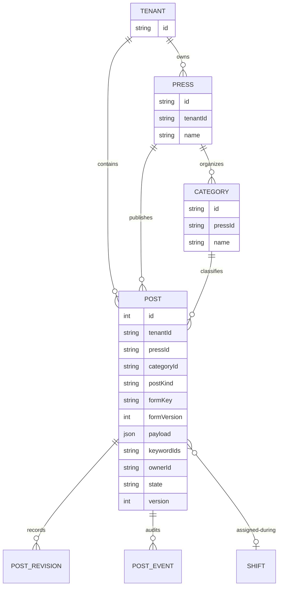

# Posts, dynamic forms, and structure rules

## Editorial hierarchy

The company is represented by a tenant. A tenant can own several presses; each press has its own categories. A Post is classified by exactly one press/category pair. A section in Shifts may include several such pairs, including pairs from different presses.

### Categories are not Keyword tags

The Contents module owns each press category. A category is part of the editorial domain: it determines where a Post belongs and participates in category-scoped grants, shift-section coverage, queues, and publication rules. A category ID is therefore not interchangeable with a Keyword ID.

Contents may optionally map an editorial category to a canonical Keyword concept when they represent the same subject (for example, the “Sports” category in a press may map to the shared Sports concept). That mapping helps search and SEO, but does not replace the category, grant tag access, or automatically tag every Post in the category.

Tags are separate associations from a Post to one or more Keyword concept IDs. Contents owns and persists those assignments with the Post; Keyword supplies canonical concepts and can build a searchable backlink projection. See [Keyword rules for tags, taxonomies, and categories](/modules/keyword/#rules-for-tags-taxonomies-and-categories).

## Post envelope and form-defined payload

Use one Contents-owned Post aggregate with a stable envelope and a JSON payload whose structure is defined by an immutable Dynamic Fields form version. A Post may be an article, news item, video, document, image post, album, reportage, photo story, or another approved format. It may also contain ordered typed blocks such as paragraphs, images, videos, documents, or albums.

| Contents-owned envelope | Dynamic Fields-owned payload definition |
| --- | --- |
| Post ID, tenant, press, category, author, post kind, lifecycle state, version, assignment/reviewer, schedule, publication snapshot, and audit history | Nested payload fields, block structure, field validation, conditional visibility/requiredness, reusable components, and immutable form versions |
| Selected FormKey and FormVersion, plus a retained schema snapshot/reference for recovery | Published schema and versioned definition package |
| Keyword IDs and asset IDs referenced by the Post | Validation of payload JSON; it does not own Posts or submitted payload values |

The selected form determines the Post payload shape; it must not define or override Contents authorization, press/category scope, editorial state transitions, shift rules, or publication permissions. Contents maps each allowed post kind to a published form version. Do not accept a client-selected form key/version without checking that mapping and tenant.

Example payload (proposed contract, not an implemented schema):

~~~json
{
  "postKind": "mixed-story",
  "form": { "key": "post.mixed-story", "version": 2 },
  "payload": {
    "blocks": [
      { "kind": "paragraph", "text": "Opening text..." },
      { "kind": "image", "assetId": "asset_21", "caption": "The venue" },
      { "kind": "video", "assetId": "asset_35", "transcript": "..." },
      { "kind": "album", "items": [{ "assetId": "asset_40", "caption": "Final" }] }
    ]
  }
}
~~~

Dynamic Fields should support a bounded discriminated block union: an allowlisted discriminator such as kind selects one declared block schema. A Post form can instead define one fixed shape, such as a video post or document post. Large media binaries stay outside both databases; payloads contain stable asset IDs and editorial metadata.

The universal title/headline, press/category, owner, publication timestamps, and workflow state stay in the Contents envelope for indexing and policy checks. Body-specific data belongs in the payload.



`SHIFT` belongs to the Shifts module; its ID is a reference, not a foreign key into another module's database. A Post pins an exact published Dynamic Fields form version; the form key/version is a contract reference, not a cross-module database foreign key. The `POST_REVISION` record is a recommended long-term model for immutable revision snapshots, including the payload and its form version. The starter code now calls its aggregate `Post` and its discriminator `PostKind`, but does not yet provide this planned payload/revision model.

## Logical structure

```text
Tenant (company boundary; resolved by host)
└── Press (tenant-owned)
    └── Category (belongs to one press)
        └── Post
            ├── stable editorial envelope
            ├── pinned Dynamic Fields form version
            ├── form-validated JSON payload
            ├── Keyword concept and media asset references
            ├── current state and concurrency version
            ├── assignment and schedule references
            ├── published snapshot
            └── append-only editorial history
```

### Stable Post envelope

| Field | Meaning / rule |
| --- | --- |
| `Id` | Contents-owned Post identifier. |
| `TenantId` | Tenant partition/security boundary, set from trusted request context. Never accepted as an arbitrary body value. |
| `PressId`, `CategoryId` | The category must belong to the selected press in this tenant. |
| `PostKind` | Approved kind such as article, news, video, document, image, album, reportage, or mixed story. Contents maps this to an allowed form version. |
| `FormKey`, `FormVersion` | Exact published Dynamic Fields form used for the payload. Store a schema snapshot or durable equivalent with each revision. |
| `Payload` | JSON instance validated against that pinned form. Contents stores and versions it; Dynamic Fields stores only definitions and validation behavior. |
| `KeywordIds`, `AssetIds` | Stable references to Keyword concepts and Media assets. Contents owns the Post associations; each referenced module owns its records. |
| `OwnerId` | Stable Identity subject who created the Post. Keep it after membership removal for audit; anonymize if account deletion policy requires it. |
| `State`, `Version` | Current editorial state and optimistic concurrency token. Every accepted state-changing command checks the current version. |
| `AcceptedAt`, `AcceptedShiftId` | When and in which shift a manager accepted it; starts the configurable auto-assignment delay. |
| `AssigneeId`, `AssignedShiftId` | Current reviewer and shift assignment. Assignment does not grant permanent access. |
| `ScheduledFor`, `PublishedAt` | Scheduled publication and live publication timestamps. |
| `PublishedSnapshot` | The exact content being served publicly while a later revision is being reviewed. |
| `History` | Actor, time, action, state, reason/detail, and related shift/assignment references. |

### Form-defined Post payload

Posts share identity, press/category, ownership, state, and revision rules. Their variable body is a JSON payload defined by a published Dynamic Fields form, avoiding an unbounded table of nullable columns. Contents maintains a server-side mapping from each permitted `PostKind` and tenant to a form version; a client cannot choose an arbitrary form to bypass policy or validation. Form changes create a new immutable version, and existing revisions remain pinned until explicitly migrated.

For mixed stories, the form can define a bounded ordered list of discriminated blocks (for example paragraph, image, video, document, or album). Only declared block kinds and their schemas are accepted. Dynamic Fields validates structure and values; Contents validates editorial and asset-reference rules. A future Media module owns binary upload, scanning, transformations, storage, and retention. The payload stores stable asset IDs and editorial metadata, never the binary itself.

Do not store video files or image binaries in the Contents relational database. A later Media module can own upload, scanning, transformations, storage, and retention; Contents owns the editorial association to those assets.

## Invariants

1. A press and category must exist and be active in the current tenant; the category's press ID must match the Post's press ID. An optional Keyword mapping is additional metadata, not a substitute for this check.
2. A user can create a Post only in a category covered by their standing `content.author` grant. Editors can have this permission in one or many press/category scopes.
3. Draft creation outside a shift is allowed for the user's own eligible categories. It does not grant review or publication rights.
4. The owner may edit a submitted Post during the agreed 24-hour window only while it has not been accepted/assigned. Manager acceptance or assignment locks owner edits. A return reopens author changes.
5. Another editor's Post can be reviewed only after explicit assignment to that editor and while the corresponding shift/category grant is active.
6. Assignment requires the manager's active `content.assign` scope and an eligible Editor on an active shift section covering that Post's press/category. Compare-and-set prevents a timer and manager action from overwriting each other.
7. Desk return/publish operations require category scope and a valid state. A Desk user who authored or reviewed the item may self-publish only if they also have the standing Editor permission for that company category.
8. An edit to a scheduled version cancels its pending publication. An edit to an already published Post moves the new revision to Desk reapproval while the previous published snapshot remains live.
9. A scheduled publish rechecks that the Post is still in the scheduled version/state and due. A stale schedule or later edit cannot publish obsolete content.
10. All commands append an auditable event and increment `Version`; retries must be idempotent or return a conflict clients can safely reconcile.
11. Keyword tags are descriptive metadata only. They do not replace the Post's required press/category assignment and do not grant access.

## State transitions

| From | Command / actor | To | Key condition |
| --- | --- | --- | --- |
| — | Author creates Post | Draft | `content.author` in Post category. |
| Draft / Returned | Author submits | Submitted | Owner and current version match. |
| Submitted | Shift Manager accepts | Accepted | Active `content.accept` and category coverage; store `AcceptedAt` and shift ID. |
| Accepted | Manager assigns | InReview | Active `content.assign`; reviewer is eligible in the section. |
| Accepted | Elsa assigns after delay | InReview | No manager assignment won first; eligible active Editor exists. |
| InReview | Assigned Editor approves | Approved | Same assignee, active review grant, and current version. |
| Submitted / Accepted / InReview / Approved | Authorized user returns | Returned | `content.return`; record reason and actor. |
| Approved / AwaitingDeskReapproval | Desk schedules | Scheduled | `content.publish`, eligible state, future time, current version. |
| Approved / AwaitingDeskReapproval | Desk publishes | Published | `content.publish` plus self-publish exception check. |
| Scheduled | Elsa publishes when due | Published | Same scheduled version remains valid and due. |
| Published / Scheduled / Approved | Desk edits | AwaitingDeskReapproval | Cancel pending schedule; preserve previous live snapshot if one exists. |

`Accepted` is intentionally separate from `InReview`: it is the manager-accepted queue state during which the configurable assignment delay runs. If no eligible editor exists, the Post remains queued and is surfaced for manager action; Elsa must not invent access or broaden scopes.

## Permission model

Permissions are plain module-defined names; grants live in the host's tenant grant store and are evaluated against current scopes/windows.

| Permission | Typical scope | Purpose |
| --- | --- | --- |
| `content.author` | Category or press | Create and submit own Posts. |
| `content.editor` | Category or press | Standing Editor role, including the agreed self-publish exception. |
| `content.accept` | Shift-provided category scope | Manager accepts submissions into the shift's queue. |
| `content.assign` | Shift-provided category scope | Manager assigns Posts; Elsa's service also needs explicitly provisioned tenant-wide automation scope for queue reconciliation. |
| `content.review` | Shift-provided category scope | Review/edit only assigned works during the active shift. |
| `content.return` | Shift-provided category scope | Desk or Shift Manager returns a Post. |
| `content.publish` | Shift/standing category scope | Desk approves publication or schedules it. |
| `content.transfer` | Shift scope; tenant-wide service grant for automation | Handover unfinished Posts safely. |
| `content.manage` | Tenant | Manage presses and categories. |

The host resolves the tenant from trusted context and compares it with token/tenant membership. Do not put press/category/shift permissions in JWT claims: grants change with the rota clock, assignment, and check-out.
