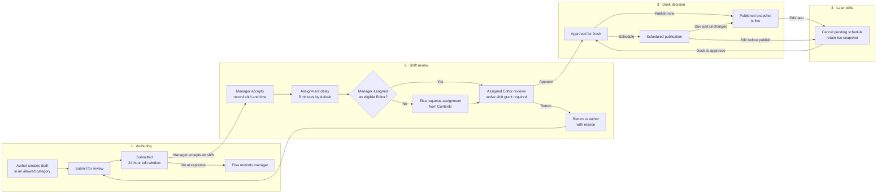
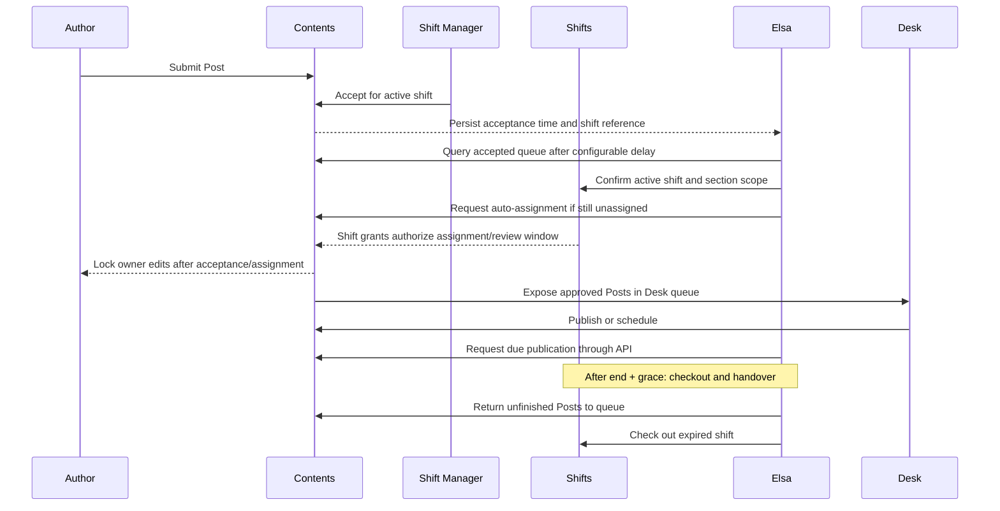
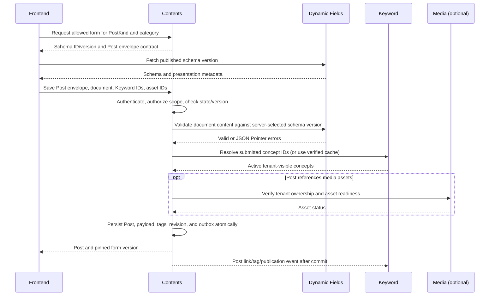

## Editorial lifecycle

The lifecycle is enforced by Contents. Shifts supplies time-bounded role grants and section coverage; Elsa waits, reminds, and issues authorized commands through module APIs.

The owner edit window is 24 hours by default. Acceptance or assignment can lock the owner earlier. The assigned Editor may edit only while assigned and while their active shift grant covers the Post. Returning the Post reopens the author path. A Desk user who wrote or reviewed the Post may publish only when they also have the standing Editor permission in that company category.

## Shift integration

Shifts owns sections, rota assignments, shift schedule, and the grants generated from the rota. A section is a set of company press/category scopes and can optionally span several presses. Manager, Desk, and Editor permissions come from the role's shift grants; these grants become inactive by clock or earlier check-out.

At shift end, access ends on the clock even if nobody checks out. Elsa waits the configurable checkout grace period (15 minutes by default), then requests automatic checkout and hands unfinished review Posts back to the Contents queue for reassignment. A manual handover is a manager action; it must end the outgoing shift's grants and transfer only the Posts selected under the agreed Shifts API contract. Contents records the transfer and preserves Post history.

Contents never directly queries the Shifts database, and Elsa never changes Content or Shifts rows directly. The API calls carry the tenant context; each module rechecks the tenant, caller, permission, scope, state, and version.

## Identity and tenancy

- Identity issues the user's token and owns the global account and tenant membership. Content uses the token subject as `OwnerId`/actor ID; it does not own passwords, user records, or membership.
- The host resolves one tenant per request and validates the tenant context. Content data is tenant-isolated using the configured tenant database/provider strategy.
- A tenant/company contains its own presses, categories, Posts, grants, rota sections, and workflow instances. A user may have different company roles and category scopes in multiple tenants.
- Post records store press and category IDs as module-owned references. A section that covers categories in two presses contains two explicit press/category scope pairs, not an inferred wildcard.
- Elsa's service identity is a confidential client. It receives only the tenant grants needed for automation and sends an explicit tenant context on each API call. Service credentials belong in the secret provider, never module catalog settings or JWT payloads.

## Service/API boundary

The canonical resource is `/api/content/posts`. `/api/content/articles` and `/api/content/works` are compatibility aliases with the same routes. Responses use Post terminology and the `postKind` field. These routes are not a final public contract yet: review filtering, pagination, response shapes, idempotency and versioning before stabilizing clients.

| Route (under `/api/content`) | Permission | Notes |
| --- | --- | --- |
| `GET /presses`, `GET /categories?pressId=` | signed in | |
| `POST /presses`, `POST /categories` | `content.manage` | |
| `GET /posts?view=Mine\|Queue\|Review\|Desk` | signed in | Each view is filtered by the caller's scopes |
| `GET /posts/{id}` | owner, assignee or a scope that sees it | Otherwise 404 |
| `POST /posts` | `content.author` | Body `NewPost`: `categoryId`, `title`, `body`, `postKind`, optional `document` |
| `PUT /posts/{id}` | depends on state | Owner, assigned reviewer, or Desk (`content.publish`); body `PostEdit` |
| `POST /posts/{id}/submit` | owner | `{ version }` |
| `POST /posts/{id}/accept` | `content.accept` | `{ version, shiftId }` |
| `POST /posts/{id}/assign` | `content.assign` | `{ version, assigneeId, shiftId }` |
| `POST /posts/{id}/approve` | `content.review` | Assigned reviewer only |
| `POST /posts/{id}/return` | `content.return` | `{ version, reason }` |
| `POST /posts/{id}/transfer` | `content.transfer` | `{ version, fromShift }` |
| `POST /posts/{id}/schedule` | `content.publish` | `{ version, publishAt }` |
| `POST /posts/{id}/publish` | `content.publish` | Plus the self-publish check |
| `POST /posts/publish-due` | `content.publish` | Publishes every due schedule; called by Elsa |
| `GET /public/{publicId}` | **anonymous** | Published snapshot only; tenant from host name or `X-Tenant` |
| `GET /automation/accepted` | `content.assign` | Accepted Posts for Elsa's assignment delay |
| `POST /automation/accepted/{id}/assign` | `content.assign` | Auto-assign to an eligible editor on shift |
| `POST /automation/shifts/{shiftId}/handover` | `content.transfer` | Returns unfinished review work to the queue; safe to repeat |

Errors are problem details: 403 for a missing right, 404 for a Post the caller may not see, 409 for a stale `version`, a concurrent change or a domain rule.

| Operation | Owner | Expected caller |
| --- | --- | --- |
| Create/edit/submit/get/list Post | Contents | Author, assignee, Desk, or authorized reader, checked per scope and state. |
| Accept, assign, approve, return | Contents | Shift Manager, active Editor, or Desk as appropriate. |
| Schedule/publish/publish-due | Contents | Desk; Elsa may invoke due processing using a tenant-scoped service grant. |
| Plan/publish rota, check in/out, read effective shift timers | Shifts | Shift Manager/admin; Elsa has narrowly granted automation access for overdue checkout. |
| Auto-assignment and shift handover commands | Contents | Elsa service after checking persisted deadlines and current shift rules; all commands revalidate. |

The API should expose stable module contracts rather than sharing internal application assemblies. If the modules later need events for search indexing, notifications, or cache invalidation, publish tenant-scoped integration events after the owning transaction commits; events complement commands and do not replace validation at the Contents boundary.

## Post document and cross-module communication

This section is the **target** design; today Contents stores the document after structural checks only and calls no other module.

Contents owns the Post envelope, the document JSON, revisions, and all editorial decisions. Dynamic Fields owns reusable definitions and immutable form versions. Keyword owns canonical concepts; Contents owns the tag assignments on each Post. A future Media module owns binary assets, while Contents owns their editorial use. These boundaries apply whether modules run in one process or separate pools.

The frontend may fetch schema and display metadata, but its validation is only a usability aid. On every write, Contents independently selects the permitted form mapping, checks the caller and Post state, validates the payload against that exact immutable version, validates Keyword and asset references, then saves the Post and an outbox event in its own transaction. A client cannot submit a different `schemaId` or `schemaVersion` to change the allowed shape. No cross-module transaction or database join is assumed.

If Dynamic Fields is unavailable, Contents may validate using a previously verified, retained schema snapshot for that exact version. Otherwise it rejects the write with a retriable service-unavailable response; it never silently skips validation. If Keyword or Media is optional and unavailable, existing IDs remain readable from saved snapshots, but new or changed references require a successful authoritative check. Events update Keyword backlinks and search projections after the Contents transaction; the source Post remains authoritative.

Dynamic Forms define data shape and field-level validation only. They cannot grant press/category access, change Post lifecycle, approve publication, or define Shifts/Elsa policy. Elsa and Shifts communicate with Contents through the same command/query APIs and cannot write Post or payload rows directly.

## Elsa's role and deployment choices

Elsa is optional orchestration infrastructure. Its workflow definitions can change timer behavior, reminders, reassignment/escalation paths, and scheduling policy, but Content remains the authority for valid state transitions. Shifts remains the authority for rota and shift clocks.

| Mode | Placement | Trade-off |
| --- | --- | --- |
| One-machine modular deployment | Enable Contents, Shifts, and Elsa in the same WebApi process/pool, with their own module services and database schemas. | Simpler operations and low network overhead; optional modules are still independently enableable. |
| Dedicated workflow pool | Separate Elsa into its own WebApi pool, with `Modules:Enabled=elsa`, its own durable database/schema, and calls to Contents/Shifts through the gateway. Keep `HotUnload=false` and upgrade by rolling restart. | Independent resource scaling and process isolation; adds service routing, secret distribution, shared package/catalog storage, and network/retry concerns. |
| ERP profile | Do not install/activate Contents, Shifts, or Elsa. | Newsroom features disappear while core Identity, Tenancy, and other ERP modules remain independent. |

In distributed deployments, all replicas must see durable workflow storage and consistent module packages/configuration. Use an outbox or equivalent delivery pattern for cross-module events. Never make an Elsa database outage corrupt Content state; queue/retry workflow commands and let the owning module validate them when retried.

## Delivery sequence

1. Agree the Post payload model, taxonomy ownership, revision/media approach, and invariants before expanding the starter entity.
2. Finalize the Content API and database migrations for every supported provider; keep tenant filters and audit/version semantics consistent.
3. Complete shift-aware authorization and tests for both direct user actions and Elsa client commands.
4. Define Elsa workflows for acceptance reminders, assignment delay, scheduled publish, and shift grace/handover. Persist timer state in Elsa, while retaining the source timestamps and transition checks in Contents/Shifts for recovery and correctness.
5. Add retries, idempotency keys, observability, operator recovery views, and an explicit policy for no eligible reviewer or failed publication.
6. Verify the same module package in all-in-one and dedicated-pool layouts, then verify that disabling/uninstalling optional newsroom modules leaves ERP modules operational.

The current code does not run Elsa workflow definitions yet. `NewsroomAutomationService`, a hosted service in the Elsa module, reconciles persisted deadlines through the APIs every `Elsa:PollInterval` (15 seconds by default). For each active tenant it:

1. gets a client-credentials token as `elsa-workflows` and sends `X-Tenant` on every call;
2. reads `GET /api/content/automation/accepted`, and for each Post whose shift's `autoAssignDelay` (from `GET /api/shifts/shifts/{id}/automation`) has passed, calls `POST /api/content/automation/accepted/{id}/assign`;
3. calls `POST /api/content/posts/publish-due`;
4. for each shift from `GET /api/shifts/overdue` whose `endsAt + checkoutGrace` has passed, calls the Content handover and then the Shifts check-out.

This is an integration starter, **not the final set of persisted Elsa workflow definitions**. Both workflow-pool replicas run the loop, so every command must stay idempotent; the Content and Shifts endpoints recheck state and version, which makes duplicate calls safe but wasteful. Convert each business timer into an Elsa workflow, or elect one runner, before treating the design as complete. See [Elsa](/modules/elsa/#current-implementation) and [Authentication and authorization](/backend/auth-design/) for the original policy and shift decisions.
