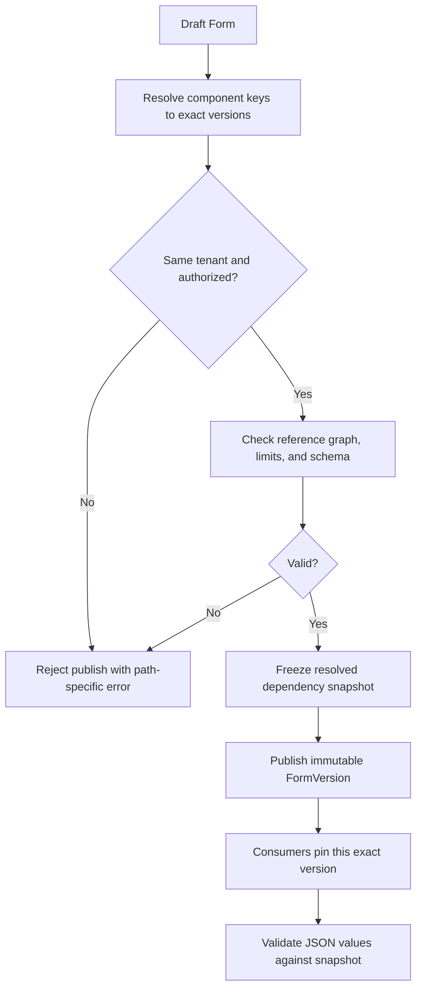

# Composition, validation, and safety rules

## Compose from immutable components

Users can compose a form from built-in fields and previously published components. A reference is always tenant-local and version-pinned. At publish time, Dynamic Fields resolves the references, checks the complete graph, and stores a self-contained snapshot with the form version.



Recommended rules:

1. Resolve references by stable component key **and explicit version**. Never mean “whatever is latest” inside an already-published form.
2. Permit composition only within the same tenant, unless the component is explicitly platform-published and read-only.
3. Reject reference cycles in the Dynamic Fields component graph. Recursive JSON data may be a valid general schema feature, but recursively composing form components makes form generation, validation budgets, and compatibility review harder.
4. Compile the graph into a self-contained schema using internal `$defs` references. Do not fetch arbitrary external `$ref` URLs at validation time.
5. Publish immutable versions. Fixes create a new version; existing consumers continue to use their pinned version until they intentionally migrate.
6. Analyze compatibility before migration: adding optional fields is usually compatible; removing fields, changing a type, making a field newly required, or narrowing constraints may invalidate existing values.

JSON Schema's `$defs` and `$ref` support reusable sub-schemas. This module should expose a constrained composition workflow over those primitives, rather than accept arbitrary remote references or permit every dialect feature by default. [JSON Schema structuring and references](https://json-schema.org/understanding-json-schema/structuring)

## Validation contract

Validation runs on the server against an immutable published version. Client-side checks are only for user experience. The validator must:

Conditional visibility and state-based rules are defined in the [Conditional visibility strategy](./conditional-visibility/). The API evaluates them server-side from submitted values and trusted consumer context; a client-supplied visibility flag never controls validation.

- Check JSON type, required keys, lengths, numeric ranges, formats, enumerations, and nested/repeating values.
- Reject unknown properties unless the schema explicitly allows them.
- Return stable error codes and JSON Pointer paths, for example `/sources/2/url`, without echoing secrets or an entire submitted document.
- Avoid silent coercion (`"12"` to `12`, local time to UTC, or a missing property to a default) unless the form contract declares a specific normalization rule.
- Validate attachment references through the consuming module's asset policy; a syntactically valid ID is not proof of access.
- Treat `format` assertion behavior explicitly. For fields where format is security/business-critical, configure the validator to assert it rather than treating it as a display annotation.

Suggested response:

```json
{
  "valid": false,
  "formKey": "post.news",
  "formVersion": 3,
  "errors": [
    { "path": "/headline", "code": "required", "message": "A value is required." },
    { "path": "/sources/2/url", "code": "format.uri", "message": "Enter a valid URL." }
  ]
}
```

## Resource and safety limits

Set limits centrally and make them configurable with safe ceilings:

- Maximum imported JSON bytes, nesting depth, total fields, references, and expanded schema size.
- Maximum array item count, string length, regular-expression length/complexity, and validation duration.
- A bounded regex engine/time budget; reject dangerous or unsupported patterns.
- No arbitrary scripts, network fetches, file reads, reflection, SQL, or custom code in definitions.
- No secrets in labels, schema metadata, import errors, logs, or export packages.
- Validate imports before writing anything; publish atomically only after every dependency and schema rule passes.

These limits protect validation throughput and form-generation clients from pathological or untrusted definitions.
