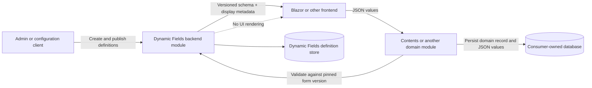

# Dynamic Fields module

Dynamic Fields is an optional **backend schema and validation module**. It lets authorized users define nested fields, compose new fields and forms from reusable definitions, validate JSON data, and import/export portable JSON packages.

It has **no representation layer**: it does not render HTML, Blazor components, controls, CSS, or form pages. It returns a stable schema plus display metadata. A frontend or consuming module decides how to render that schema. Server-side validation remains authoritative regardless of client.

## Recommendation

Use [JSON Schema Draft 2020-12](https://json-schema.org/specification) as the data-validation language, wrapped in a platform-owned versioned JSON package that carries form identity and display metadata. Reuse components through pinned, tenant-local versions and compile them into a self-contained schema at publish/export time. Avoid a proprietary tree-only validator and avoid arbitrary remote `$ref` resolution. JSON Schema supports modular schemas through `$defs` and `$ref`; the platform should constrain those features for safe, reproducible forms. [JSON Schema composition](https://json-schema.org/understanding-json-schema/structuring)

| Dynamic Fields owns | Consumer owns | Frontend owns |
| --- | --- | --- |
| Field/component definitions, form schema versions, schema composition, publishing, import/export, and validation results | Domain records, domain lifecycle, persistence of submitted values, and policy for when values are required | UI components, layout/rendering, client-side convenience validation, accessibility, and interaction design |

Dynamic Fields can be disabled or absent in an ERP deployment. A module may use only its static domain fields, or declare an optional capability dependency when it needs dynamic values. In the newsroom profile, Contents uses published forms to define the JSON payload for each Post kind, including article/news, video, document, image, album, and mixed ordered-block posts. Contents still owns the Post envelope, submitted payload values, revisions, authorization, and editorial lifecycle; Dynamic Fields owns only reusable form definitions, immutable schema versions, and validation. This is a planned integration, not an implemented capability.

## Suggested page structure

- [Definition model and nested field types](./definition-model/) covers the authoring model, reusable components, and stable field identity.
- [Conditional visibility](./conditional-visibility/) covers fields shown or required based on other values or trusted record/form state.
- [Composition, validation, and safety rules](./composition-validation/) covers reference pinning, nesting limits, validation semantics, and security.
- [JSON package, APIs, and module integration](./json-and-integration/) covers import/export, lifecycle, permissions, and consuming-module patterns.

## Module boundary diagram

## Status

This section is a **prototype strategy**, not a claim that a Dynamic Fields module is implemented. The recommended first slice is: create draft definition → validate definition → publish immutable version → validate JSON values → export/import the versioned package.
