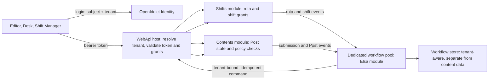

:::note[Status]
The Elsa runtime module exists (`src/WebApi/Modules/Custom/Elsa`, module `elsa` 0.1.0) and runs in the Hybird lab's `workflow` pool. It hosts the Elsa engine, API and tenant adapters, but **no workflow definitions yet**: the newsroom timers run in a hosted polling service. See [Current implementation](#current-implementation).
:::

## Recommendation

Run Elsa in a **dedicated `workflow` pool**: separate WebApi processes that load only the trusted Elsa runtime module. Set `HotUnload = false`; upgrade by rolling the pool. This is the selected strategy. Treat Elsa as a workflow engine and timer coordinator, not as the owner of newsroom business data or authorization.

- The **identity service** authenticates people and issues a token for one tenant.
- The **WebApi host** resolves and verifies the tenant, then enforces permissions and scoped grants.
- The **shifts module** owns sections, rotas, check-in/check-out, and the time-windowed grants produced by the rota.
- The **Contents module** owns Posts; `PostKind` distinguishes article, news, video, reportage, and other kinds. Contents validates every Post state transition, assignment, edit, return, and publication.
- **Elsa** coordinates durable steps and timers, then asks the owning module to perform a transition through an authenticated API or message.



This keeps domain ownership clear and prevents a timer or an Elsa outage from becoming the security boundary. Access is granted only by the host after it checks the current tenant, current time window, and resource scope.

## Deployment decision: dedicated workflow pool

The selected deployment follows the original runtime-module strategy: Aspire starts a separate set of WebApi processes for the `workflow` pool, and those processes load only the trusted Elsa module. Do not load Elsa into the core, sales, or worker pools. Disable hot unload; publish an Elsa module upgrade by rolling the workflow replicas.

This is **process isolation from the other WebApi pools**, not an independent Elsa executable. Elsa runs inside the WebApi host process for each workflow replica, using the host's runtime-module loader and a private pipeline for the Elsa API/Studio endpoints. User requests and delayed operations still cross service boundaries to the content and shifts pools; the workflow pool does not reach into their in-memory services or databases.

### What this choice gives up versus a standalone Elsa Server

| Concern | Dedicated workflow pool with Elsa module — selected | Standalone Elsa Server project/process |
| --- | --- | --- |
| Process isolation | Isolated from core, sales, and worker processes because it has its own pool. | Also isolated. It does not add more pool-to-pool failure isolation than the selected design. |
| Deployment and versioning | Uses the WebApi host image, module contract, and release pipeline. `HotUnload = false` means module upgrades require rolling workflow-pool restarts. | Elsa host and WebApi can release and upgrade independently, with separate build and deployment pipelines. |
| Elsa hosting pipeline | Must fit Elsa hosted services and routes into the runtime module lifecycle and a private sub-pipeline. This is the main technical cost and needs an integration spike. | Uses Elsa's own ASP.NET Core host and native middleware/endpoint setup; no WebApi module sub-pipeline is needed. |
| Dependency/version coupling | Elsa packages share the workflow process's WebApi host dependency graph and must remain compatible with its .NET/ASP.NET Core and module contracts. Other pools are unaffected, but the workflow host and Elsa module are coupled. | Elsa dependencies and upgrade cadence are independent of WebApi host packages. |
| Infrastructure and operations | Reuses Aspire pool conventions, health/telemetry setup, tenant-aware host adapters, and the existing runtime-module deployment model. | Adds another application, image, configuration surface, deployment pipeline, health/telemetry setup, routing, and secret/service identity configuration. |
| Cross-process integration | Still required: Elsa calls the content/shifts APIs or uses messages because those modules live in other pools. | Also required, and applies to all WebApi interactions. |
| Scaling | Scale workflow replicas independently from API pools. | Also scales independently. |
| Tenant and authorization model | Same tenant-bound workflow records and host-checked commands described on this page. | No security shortcut: it needs the same tenant propagation, service identity, permission mapping, and host enforcement. |

**Accepted tradeoffs:** we give up an independently versioned Elsa host and Elsa's native top-level ASP.NET Core pipeline. In return, we keep the existing runtime-module packaging and deployment model, while retaining process isolation and independent scaling from the other pools. We do **not** accept mixing Elsa with the public API pools or allowing live unload.

Choose a standalone Elsa Server later only if the module-hosting spike shows the private pipeline or hosted-service lifecycle is unreliable, Elsa's dependencies cannot be kept compatible with the workflow host, or Elsa needs a release cadence independent of the WebApi host. The tenant, message, authorization, and domain-ownership contracts should stay the same either way.

## Current implementation

There are two architectures in the repository; do not conflate them.

| Area | State |
| --- | --- |
| New `src/WebApi` runtime host | Elsa 3.9 runs as the custom runtime module `elsa` (`WebApi.Modules.Elsa.Infrastructure`, a single project). |
| Older `src/api/ModularBlazor.Host` | Elsa is embedded as `ElsaHostModule`, with Finbuckle tenancy and the older permission adapter. Treat it as reference only. |

### What the `elsa` module does

| Piece | Implementation |
| --- | --- |
| Manifest | Id and route prefix `elsa`; `HotUnload = false`; permissions `workflow.view`, `workflow.design`, `workflow.run`; settings `Elsa:Schema` (`elsa`), `Elsa:RunMigrations` (`true`), `Elsa:PollInterval` (`00:00:15`) |
| Hosting | Implements `IModulePipeline`: Elsa's middleware and API run in a private pipeline behind `/api/elsa/{**path}`, after the host has resolved the tenant and authenticated the caller (`RequireAuthorization`) |
| Persistence | Elsa workflow management and runtime stores on EF Core PostgreSQL, from `ConnectionStrings:elsa`, schema `elsa`; Elsa runs its own migrations |
| Tenancy | `ElsaPlatformTenantResolver` hands Elsa the tenant the host already resolved; `ElsaPlatformTenantsProvider` lists active tenants from `ITenantDirectory`. Elsa has no tenant list of its own |
| Authorization | `ElsaWorkflowPermissionMiddleware` maps Elsa API calls to host grants: `workflow-instances` → `workflow.run`, other reads → `workflow.view`, other writes → `workflow.design` |
| Automation | `NewsroomAutomationService` (a `BackgroundService`) polls the Content and Shifts APIs as client `elsa-workflows`; see [Workflow and module integrations](/modules/contents/workflow-and-integrations/#delivery-sequence) |

### Secrets and settings

The module needs values that must not be stored in the module catalog, so the runtime injects them from the host's configuration into this module's private settings: `ConnectionStrings:elsa`, `Identity:ElsaClient:ClientId`, `Identity:ElsaClient:ClientSecret`, `Elsa:IdentityAuthority` and `Elsa:PlatformApiBaseUrl`. In the Hybird lab the client secret is the Aspire parameter `elsa-client-secret`; set it once with user-secrets:

```bash
dotnet user-secrets set "Parameters:elsa-client-secret" "<dev-secret>" --project src/Aspire/Hybird
```

### Open issues

| Issue | Why it matters | Suggested fix |
| --- | --- | --- |
| No Elsa workflow definitions | Timers live in a polling loop, not in durable, inspectable workflows | Model assignment delay, scheduled publish and checkout grace as Elsa workflows |
| Both workflow replicas run the poller | Every command is sent twice; correctness relies on idempotent endpoints | Elect one runner (distributed lock in Redis or the database), or let Elsa's scheduler own the timers |
| The secret injection is hard-coded for the module id `elsa` in `ModuleRuntime` | Any other module that needs a host secret needs a host change, and any package that claims the id `elsa` receives these secrets | A manifest-declared list of required host keys, allowlisted per module id by the operator |
| `Elsa:PlatformApiBaseUrl` is `http://localhost:5080` in the AppHost | Breaks outside the lab | Use the gateway's service-discovery reference |
| Typed `HttpClient` held by a singleton hosted service | `HttpClient` handlers are never rotated, so DNS changes are missed | Use `IHttpClientFactory.CreateClient` per cycle |
| Elsa's file-system distributed lock with 2 replicas | Locks are not shared across processes | Configure a Redis or PostgreSQL distributed lock provider |

Relevant code: `src/WebApi/Modules/Custom/Elsa/WebApi.Modules.Elsa.Infrastructure/ElsaModule.cs`, `NewsroomAutomationService.cs`, `src/WebApi/WebApi/Modularity/ModuleRuntime.cs` (secret injection), `src/Aspire/Hybird/AppHost.cs` (workflow pool).

## Tenant propagation and data isolation

There are two tenant contexts to handle:

1. **HTTP request:** the WebApi host resolves the tenant from its trusted request context and confirms it matches the signed token's `tenant` claim. Elsa API requests need equivalent authentication and tenant resolution.
2. **Delayed workflow execution:** there may be no original HTTP request. Persist the tenant ID with the workflow instance and its business identifiers. When Elsa resumes the workflow, validate that tenant against the platform directory and create an explicit tenant-bound service scope before executing the next step.

Do not trust a tenant ID supplied only in a message body or caller-controlled header. Authenticate the Elsa workload and constrain it to an explicit set of tenants or a tenant-bound service identity. Preserve the initiating user's ID for audit, but do not treat a stale user token as authority for a timer that fires later.

Use a dedicated Elsa workflow database and schema, separate from tenant content databases. It can live on the same PostgreSQL server as other platform databases. This tightens the original “own PostgreSQL schema” guidance by isolating Elsa's migrations and backups at the database boundary. A shared workflow database can serve the SaaS deployment if every Elsa persistence and auxiliary store is tenant-aware and that isolation is verified for the Elsa version in use. This also avoids coupling workflow persistence to the multiple database engines supported by tenant business data. Dedicated customer deployments can use their own Elsa database.

Elsa's multitenancy documentation explicitly distinguishes tenant resolution from storage isolation and calls out stores that may not apply tenant filtering. Verify every store used by Elsa and any custom activity before enabling a tenant. [Elsa multitenancy setup](https://docs.elsaworkflows.io/multitenancy/setup.md)

## Authentication and authorization

- Keep **OpenIddict Identity** as the only user identity authority. Do not create a second Elsa user database or copy press, category, or shift roles into Elsa.
- User tokens stay tenant-bound and contain stable identity claims such as `sub` and `tenant`. Press/category scopes and shift grants remain server-side and are checked by the host at request time.
- Authenticate the Elsa process as a workload. Its delayed commands must be tenant-bound, narrowly authorized, and auditable. The lab uses the confidential client `elsa-workflows` (client credentials, scope `api`); its tokens carry no tenant, so each call names the tenant with `X-Tenant` and the host checks the client's grants in that tenant.
- Protect Elsa's own management API separately with least-privilege workflow administration permissions. Elsa API permissions do not replace application permissions, and Elsa API permissions do not secure HTTP-triggered workflow routes. [Elsa authentication and authorization](https://docs.elsaworkflows.io/guides/authentication.md)
- Never use a broad `*` permission mapping for ordinary editors or Desk users. In the legacy host, `ElsaPermissionTransformation` gives generic workflow permissions based on a simple role check; that is too broad for the new scoped newsroom policy.

### Press/category scope

The current Shifts module stores a section's category IDs and writes grants with scopes such as `category:{id}`. The newsroom requirement allows a section to span categories from several presses. Therefore either make category IDs globally unique and enforce that invariant, or change the scope to include both IDs, for example `press:{pressId}:category:{categoryId}`. The content module must authorize against the same press/category pair. Tenant remains the outer boundary in either design.

## Workflow boundaries

For the newsroom process:

- When a Shift Manager accepts a submission, Elsa may start the configurable auto-assignment delay (five minutes by default). A manager's assignment wins if accepted before the timer; otherwise Elsa requests automatic assignment from the content/shifts application API. Elsa never accepts a submission on the manager's behalf; it reminds the manager if the submission is still unaccepted.
- The shift module remains authoritative for the rota and checkout. Elsa may schedule the grace-period action (15 minutes by default), but the host enforces grant expiry from the shift clock even if Elsa is unavailable. At grace-period expiry, Elsa checks the shift out and transfers unfinished work to the incoming queue; for an early manager checkout, the outgoing manager chooses what transfers.
- A Desk user or Shift Manager can return work according to the active tenant/shift/category grants. The content module performs the return and records the state transition.
- Publishing, scheduled publication, edits after publication, and re-approval remain content-module rules. Any later edit cancels a pending publication schedule, keeps the current live version available, and sends the edited version back for Desk re-approval. Elsa can orchestrate a scheduled action, but cannot bypass the content module's authorization or state checks.

Every command must be **idempotent** and safe under retries and races. For example, an automatic assignment must not replace an assignment made by the manager seconds earlier. Use a transactional outbox for domain events sent to Elsa, and make the receiving side deduplicate them. Keep Post payloads out of workflow variables; store only identifiers and the minimum state needed to resume.

## Integration shape

1. Add a dedicated `workflow` pool to Aspire and load the trusted Elsa runtime module there only. Keep other modules out of that pool, disable hot unload, and upgrade it by rolling restart.
2. Give the module its own health checks, tenant-aware workflow persistence, and a private API sub-pipeline. Add a thin integration adapter for tenant-bearing events and authenticated, typed commands.
3. Include `TenantId`, shift/Post IDs, correlation/idempotency keys, workflow version, and initiating actor in durable workflow context.
4. Route every delayed action back through the owning shifts/content module API or command handler. The host rechecks tenant status, current grants, and domain state at execution time. Map narrowly scoped workflow design/run permissions into Elsa's API permission claims; never grant every newsroom user a wildcard Elsa permission.
5. Test tenant crossing, suspended tenants, checkout while a workflow is waiting, duplicate delivery, manager/automatic assignment races, and Elsa restart/replay before production.

### Decision in one sentence

**Elsa owns orchestration and timers; the platform identity service owns users and tenant memberships; the WebApi host owns authorization; Shifts owns the rota; Contents owns Posts and their state.**
